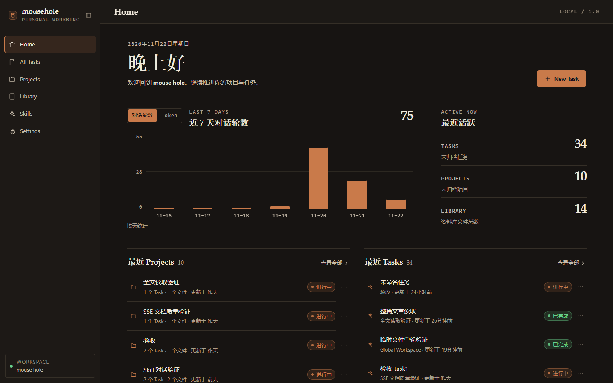
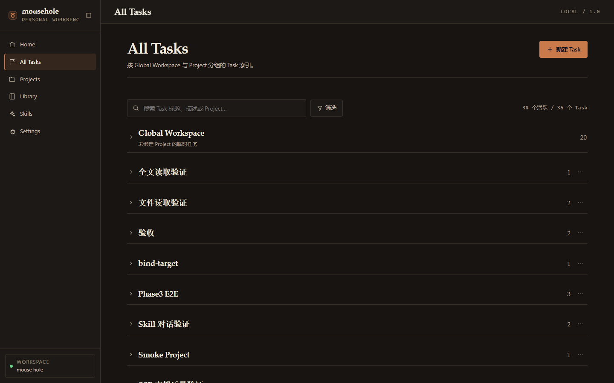
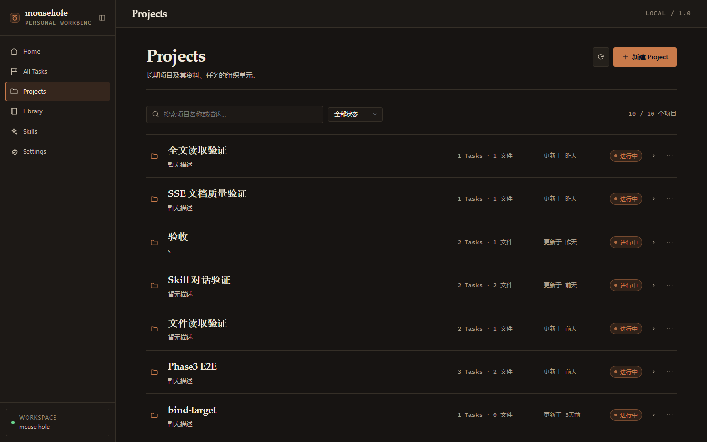
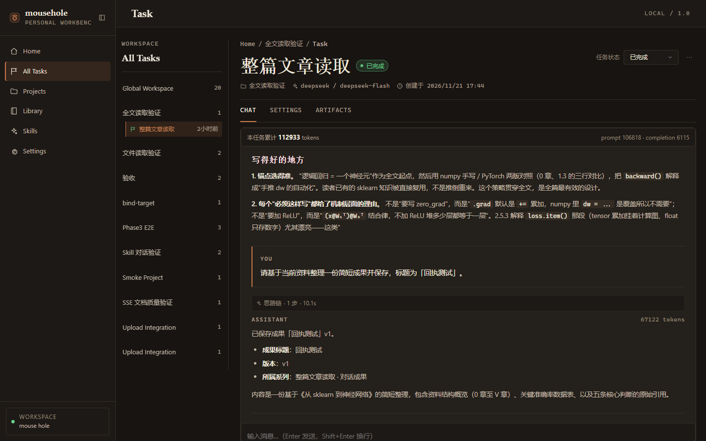

# mousehole

> 面向个人用户的 **Local-first AI Workspace**：把资料、任务、执行过程和成果沉淀在同一个持续存在的工作空间里。

**状态：v0.3.0 已交付（Phase 5「复用与效率」完成：成果可存入 Library 复用、聊天上下文可清空/恢复、内置流程沉淀 Skill）；可信能力后置。** 后续阶段规划见 [演进路线](docs/ROADMAP.md)。

## 核心闭环

```text
创建 Project → 上传多份资料 → 创建 Task → 组织上下文
      → 模型分析 → 生成 Markdown Artifact → 重启后继续复用
```

- Workspace → Project → Task → Execution → Artifact；
- File 提供资料，Conversation 记录交流；
- 纯本地优先，数据默认保存在本机。

## 界面预览

| Home | All Tasks |
| --- | --- |
|  |  |

| Projects | Task |
| --- | --- |
|  |  |

## 快速开始（Docker，推荐）

### 第一次启动

前提：安装并启动 Docker Desktop；本机 8090 端口可用。

```powershell
cd E:\VScode\Mousehole
copy .env.example .env        # 环境变量模板；.env 不入 Git
docker compose up -d --build  # 构建镜像并后台启动全部服务
```

打开 **http://localhost:8090**。首次启动会自动执行数据库迁移并创建默认 Workspace。

首次使用还需要在 **Settings** 配置 Provider（DeepSeek / OpenAI / Ollama）并点「测试连接」；API Key 保存在本机 `data/provider_config.json`，接口只返回掩码。

> Docker 模式连接宿主机 Ollama 时，地址用 `http://host.docker.internal:11434`；本机直跑 backend 时用 `http://127.0.0.1:11434`。`OLLAMA_BASE_URL` 在 `.env` 中配置。

### 日常使用（重点）

**第一次启动成功后，以后只需要保证 Docker Desktop 正在运行，然后打开 8090 即可，不用敲任何命令。**

- 三个容器都使用 `restart: unless-stopped`，Docker 启动时会自动恢复；
- 如果执行过 `docker compose stop` 或 `down`，需要执行一次 `docker compose up -d`；
- 改代码后需要 `docker compose up -d --build`；
- 永远不要执行 `docker compose down -v`（会删除数据库卷）。

### 常用 Docker 命令

```powershell
docker compose up -d --build   # 改代码后：重建镜像并启动
docker compose up -d           # 启动已有容器（不重建）
docker compose ps              # 查看容器状态与端口
docker compose logs -f backend # 跟踪后端日志
docker compose stop            # 停止容器，保留数据
docker compose start           # 启动已停止的容器
docker compose down            # 删除容器，保留数据卷
```

- 只更新 Docker Desktop：容器通常会自动恢复；没起来就执行一次 `docker compose up -d`；
- 更新代码：`docker compose up -d --build`；
- 更新 PostgreSQL 镜像（可选）：先备份，再 `docker compose pull postgres`、`docker compose up -d`。

### 开发模式（热更新）

生产模式和开发模式共用 project name 与数据卷，**不要同时启动**。

```powershell
docker compose down
docker compose -f docker-compose.dev.yml up -d
# 前端 http://localhost:5173，后端 http://localhost:8000，保存代码自动热更新
```

回到生产模式：

```powershell
docker compose -f docker-compose.dev.yml down
docker compose up -d
```

### 数据与备份

| 数据 | 位置 |
|---|---|
| 数据库 | Docker 卷 `mousehole_pgdata` |
| 上传文件 | `storage/` |
| Provider 配置/API Key | `data/provider_config.json`（明文，勿提交） |
| 备份 | `backups/<timestamp>/` |

```powershell
.\scripts\backup.ps1                                      # 备份数据库 + storage
.\scripts\restore.ps1 -BackupDir .\backups\<时间戳> -Force  # 覆盖恢复
```

备份默认不包含 Provider API Key，恢复后需要在 Settings 重新填写。

## 测试

```powershell
# 后端
cd backend
.\.venv\Scripts\python.exe -m pytest tests -q       # 当前 107 passed

# 前端构建
cd ..\frontend
npm run build

# Playwright E2E（需 Docker 8090 运行；Mock API，不调用真实模型）
npm run test:e2e                                      # 当前 3 passed（1 skipped: real-model）
```

E2E 默认使用系统 Edge（`channel: 'msedge'`）；无 Edge 时执行 `npx playwright install chromium` 并调整 `playwright.config.ts`。

## 主要能力

- Project / Task / File 管理，支持 PDF / Markdown / TXT / JSON / YAML / CSV / HTML / CSS 文本资料；
- All Tasks 全局索引：按 Global Workspace / Project 分组，支持置顶、筛选、三点菜单；
- Skill Library：名称必填，描述/指令/System Prompt 可选；创建时可直接上传文件或文件夹；
- Task Chat：SSE 流式输出、临时文件单轮引用、Skill 引用、受控工具调用；
- Execution：确定性 Pipeline、状态/阶段进度、取消、文件快照、失败显式；
- Artifact：独立版本化成果，支持下载与删除；
- Home 统计（7 天柱状图）、Project Overview、Library 搜索/筛选/排序；
- Docker 生产/开发交付、数据持久化、备份恢复、Playwright E2E。

## 文档

- [演进路线：Phase 5+ 阶段规划与交付结果](docs/ROADMAP.md)
- [架构](docs/ARCHITECTURE.md) · [数据模型](docs/DATA_MODEL.md) · [界面与交互指南](docs/UI_GUIDE.md)
- [工程约束](AGENTS.md)
- [MVP 文档归档（只读）](docs/archive/mvp/INDEX.md) · [项目学习笔记](docs/notes/PROJECT_LEARNING_GUIDE.md)

> 现行规范以 `ROADMAP.md` + `ARCHITECTURE` / `DATA_MODEL` / `UI_GUIDE` 为准；MVP 期文档已归档冻结，仅供参考。

