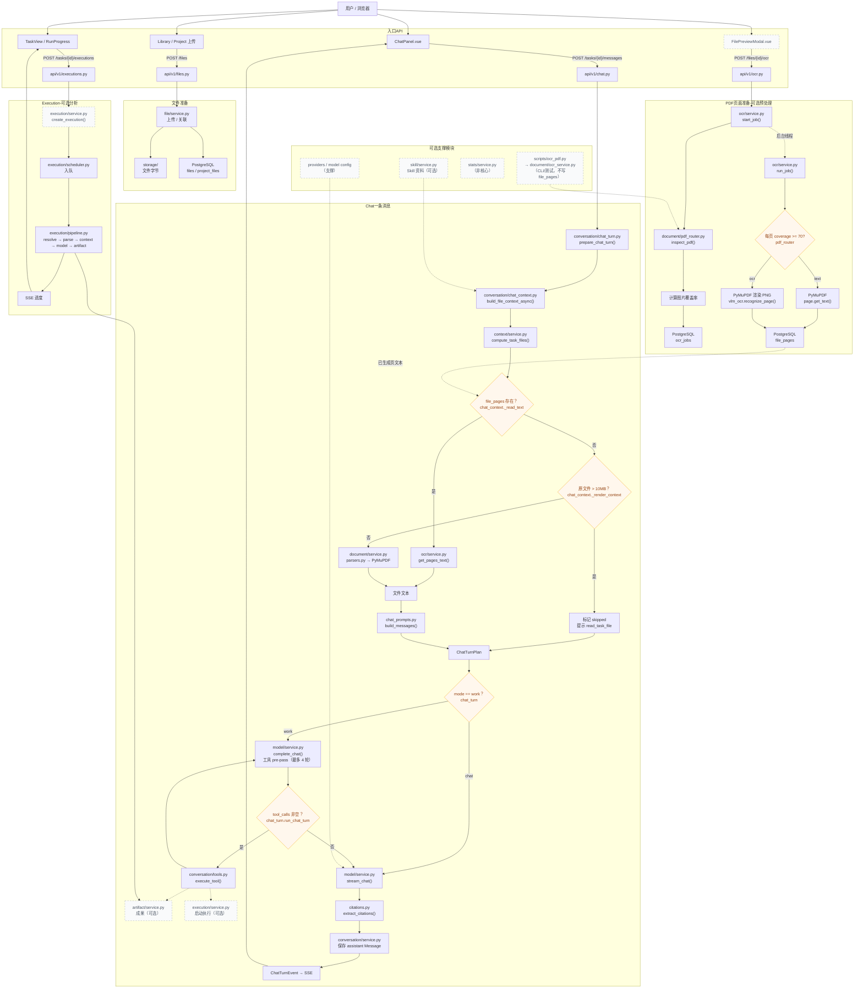

# ARCHITECTURE.md — mousehole 系统架构

**文档版本：** v0.3.0（Phase 6 进行中）  
**状态：** living（长期维护）  
**最后更新：** 2026-11-27  
**定位：** 当前系统的整体结构、仓库职责、四层技术边界与模块衔接方式。字段级细节以代码与迁移为准。  
**相关文档：** `ROADMAP.md`（阶段规划）、`DATA_MODEL.md`（数据不变量）、`UI_GUIDE.md`（界面）、`AGENTS.md`（工程约束）。

---

## 1. 系统定位与不变量

mousehole 是面向个人用户的 **Local-first AI Workspace**，采用**模块化单体**：单用户、本地部署优先，前端只通过 REST + SSE 访问后端。

任何阶段都不能破坏的不变量：

1. **分层方向**：`api → service → repository → infrastructure`；模块之间优先走公开 Service，Infrastructure 不得反向依赖业务。
2. **Execution 状态唯一来源**：状态只能由 Execution Service 修改；前端只读。
3. **工具受控**：模型只能调用 `TOOLS_SPEC` allowlist 内的工具，无 Shell、无任意文件系统、无未经确认的外部写。
4. **成果独立**：Artifact 不依赖 Conversation 存在；新版本不覆盖历史；来源可追溯。
5. **上下文显式**：可用上下文 ≠ 实际输入；必须按预算构建，禁止无预算拼接全文。
6. **失败显式**：解析、模型、保存失败必须显式失败并留痕；取消 ≠ 失败。

**单一事实源：** 表结构以 `backend/app/modules/*/models.py` + `backend/alembic/versions/` 为准；API 以 FastAPI 路由/OpenAPI 为准；界面以 `frontend/src` 为准。

---

## 2. 整体架构

### 2.1 运行时拓扑

```text
浏览器（Vue 3 SPA）
   │  REST + SSE（/api/v1）
   ▼
Nginx（生产） / Vite dev server（开发）
   │  反向代理
   ▼
FastAPI（backend/app/api/v1）
   │
   ├── Service 层（业务规则/事务）
   │      ├── Repository → SQLAlchemy → PostgreSQL
   │      ├── File/Storage → storage/（内容寻址）
   │      └── Model Adapter → OpenAI / DeepSeek / Ollama
   │
   └── OCR 任务线程（进程内）
          ├── PyMuPDF：PDF 页路由与渲染
          └── Qwen3-VL（Ollama OpenAI 兼容接口）：页图 OCR
```

### 2.2 部署形态

- **生产**：`docker compose` 启动 frontend（Nginx）、backend、PostgreSQL。
- **开发**：`docker-compose.dev.yml` 启动 Vite dev server、FastAPI reload、PostgreSQL。
- **本地数据**：`data/`（配置）、`storage/`（文件字节）、PostgreSQL 数据卷。
- **模型**：DeepSeek/OpenAI 走外网；Ollama/Qwen3-VL 跑宿主机，容器通过 `host.docker.internal` 访问。
- **单实例假设**：进程内 Scheduler、进程内 OCR 任务线程；不做多副本调度。

---

## 3. 仓库地图

### 3.1 顶层结构

```text
mousehole/
├── backend/                 FastAPI 后端
│   ├── app/
│   │   ├── api/v1/           HTTP/SSE 路由
│   │   ├── modules/          业务能力模块
│   │   ├── core/             配置、日志
│   │   ├── shared/           异常、枚举、usage、DB 类型
│   │   └── infrastructure/   SQLAlchemy Base/Session/模型注册
│   ├── alembic/              数据库迁移
│   └── tests/                pytest
├── frontend/                Vue 3 前端
│   ├── src/api/             HTTP/SSE 客户端与 DTO
│   ├── src/components/      核心页面组件
│   ├── src/views/           页面
│   ├── src/composables/     流式/执行状态
│   ├── src/stores/          Pinia 跨页状态
│   ├── src/router/          路由
│   ├── src/utils/           SSE、格式化、文件类型
│   └── src/styles/          设计 token 与全局 CSS
├── scripts/                 OCR CLI、备份/恢复、测试脚本
├── docs/                    ROADMAP / ARCHITECTURE / DATA_MODEL / UI_GUIDE
├── data/                    Provider 配置等本地数据（不入 Git）
├── storage/                 文件内容寻址存储（不入 Git）
├── docker-compose*.yml
├── .env.example
├── README.md
└── AGENTS.md
```

### 3.2 前端核心模块

```text
frontend/src/
├── api/            HTTP/SSE 客户端与 DTO（client/chat/endpoints/types）
├── composables/    Chat 流、Execution 进度
├── components/     ChatPanel / FilePreviewModal / TaskArtifacts / RunProgress
├── views/          TaskView / LibraryView / ProjectDetailView
├── stores/         app.ts
└── utils/          sse.ts
```

### 3.3 后端 API 核心路由

```text
backend/app/api/v1/
├── chat.py          Chat HTTP/SSE
├── ocr.py           OCR / 页文本
├── files.py         文件 / Library
├── executions.py    Execution 创建/查询/SSE
├── tasks.py         Task CRUD
├── task_files.py    Task 可用文件
├── projects.py      Project / 项目文件
├── artifacts.py     成果系列/版本/导出
└── supporting       skills / providers / models / stats / health
```

### 3.4 后端 modules 核心模块

```text
backend/app/modules/
├── conversation/    Chat 主干（chat_turn/chat_context/chat_prompts/tools）
├── context/         Task 可用文件与预算（service/builder）
├── document/        PDF/文本解析（service/parsers/pdf_router/ocr_service/vlm_ocr）
├── ocr/             页文本与任务（service）
├── file/            文件与存储（service/storage）
├── model/           Provider 与模型（service/adapters）
├── execution/       状态机与流水线（service/pipeline/scheduler）
├── artifact/        成果系列/版本（service）
└── supporting       task / project / skill / workspace / stats
```

> 只给核心模块加注释；内部文件不逐行解释。`models.py` / `repository.py` / `schemas.py` 分别负责表结构、数据库查询、API DTO，跨模块优先调用 `service.py`。

---

## 4. 四层架构

### 4.1 前端层（Vue 3 SPA）

**技术栈 / SDK**

| 技术 | 用途 |
|---|---|
| Vue 3.5 + TypeScript | 页面与组件 |
| Vite 6 | 开发/构建 |
| Vue Router 4 | 页面路由 |
| Pinia 2 | 跨页共享状态 |
| 原生 `fetch` | HTTP 请求（未使用 Axios） |
| 自定义 `utils/sse.ts` | 解析 SSE 帧（Chat/执行） |
| Vitest 5 + Playwright | 单测与 E2E |
| 原生 CSS 变量 | 主题与组件样式（不引入组件库） |

**文件位置**

- 页面：`frontend/src/views/`（Home、Tasks、Task、Projects、ProjectDetail、Library、Skills、Settings）
- 路由：`frontend/src/router/index.ts`
- 壳层：`frontend/src/components/AppShell.vue`
- 页面组件：`frontend/src/components/`（ChatPanel、TaskArtifacts、FilePreviewModal、RunProgress 等）
- API 客户端：`frontend/src/api/client.ts`（base URL、超时、错误归一化）
- API 方法：`frontend/src/api/endpoints.ts`
- Chat SSE：`frontend/src/api/chat.ts` + `frontend/src/composables/useChatStream.ts`
- 执行进度：`frontend/src/composables/useExecutionProgress.ts`
- 类型：`frontend/src/api/types.ts`
- 全局状态：`frontend/src/stores/app.ts`

**核心边界**

- 页面不直连数据库/模型供应商，只调用 `api/endpoints.ts`。
- SSE 断开后重新拉取状态，不把断流直接判定为失败。
- 组件不写业务规则；纯逻辑放 `utils/` 或 `composables/`。

---

### 4.2 后端层（FastAPI + 模块化单体）

**技术栈 / SDK**

| 技术 | 用途 |
|---|---|
| Python 3.14 | 运行时 |
| FastAPI + Uvicorn | HTTP/SSE 服务 |
| Pydantic v2 | API DTO 与校验 |
| SQLAlchemy 2.x（同步） | ORM |
| Alembic | 迁移 |
| PostgreSQL + pg8000 | 数据库 |
| httpx | Provider / Ollama / VLM HTTP 调用（无官方 SDK） |
| PyMuPDF | PDF 路由、页文本、页图渲染 |
| pypdf | 旧 PDF 文本提取路径 |
| python-multipart | 文件上传 |
| pytest + TestClient | 测试 |

**分层**

```text
api/v1/*.py
  ↓ 调用公开 Service
modules/*/service.py
  ↓ 调用 Repository / 其他模块公开 Service
modules/*/repository.py
  ↓ ORM
infrastructure/database + modules/*/models.py
  ↓
PostgreSQL
```

**模块职责**

| 模块 | 职责 | 关键文件 |
|---|---|---|
| workspace | 单例 Workspace、默认配置 | `modules/workspace/` |
| project | Project CRUD、归档、项目文件关联 | `modules/project/` |
| task | Task CRUD、Project 绑定、删除清理 | `modules/task/` |
| file | 上传、哈希、存储、Library、引用保护、项目私有文件 | `modules/file/` |
| document | 文本解析、PDF 页级路由、VLM OCR 客户端/编排 | `modules/document/` |
| ocr | `file_pages` / `ocr_jobs` 持久化与任务执行 | `modules/ocr/` |
| context | Task 可用文件、预算、分批、摘要 | `modules/context/` |
| conversation | Conversation/Message、Chat 上下文、受控工具、一轮对话编排 | `modules/conversation/` |
| model | Provider 配置、模型解析、流式/非流式调用、usage | `modules/model/` |
| execution | 状态机、Scheduler、确定性 Pipeline、快照 | `modules/execution/` |
| artifact | 成果系列/版本、来源、下载/删除 | `modules/artifact/` |
| skill | Skill Library、文件附件、Task 引用 | `modules/skill/` |
| stats | Home 只读统计 | `modules/stats/` |

**核心入口**

- 应用装配：`backend/app/main.py`
- 配置：`backend/app/core/config.py`
- 日志/request-id：`backend/app/core/logging.py`
- 统一异常：`backend/app/shared/exceptions.py`
- DB Session：`backend/app/infrastructure/database/session.py`
- 模型注册：`backend/app/infrastructure/database/models.py`

---

### 4.3 API 层（REST + SSE）

**约定**

- 前缀：`/api/v1`
- 普通接口：JSON；错误统一为：

```json
{"error": {"code": "not_found", "message": "文件不存在", "details": null}}
```

- 流式接口：`text/event-stream`（Chat、Execution 进度）
- 无登录/权限系统；部署边界即安全边界。
- 请求带 `X-Request-ID`，日志脱敏。

**路由文件**

| 文件 | 资源 |
|---|---|
| `api/v1/router.py` | 路由汇总 |
| `api/v1/workspaces.py` | Workspace |
| `api/v1/projects.py` | Project、项目文件 |
| `api/v1/tasks.py` | Task |
| `api/v1/task_files.py` | Task 文件上下文/临时文件 |
| `api/v1/files.py` | Library 文件、原始字节预览、内容读取 |
| `api/v1/chat.py` | Chat HTTP/SSE 适配（编排在 `modules/conversation/chat_turn.py`） |
| `api/v1/executions.py` | Execution 创建/查询/SSE |
| `api/v1/artifacts.py` | Artifact/Series、下载、存入 Library |
| `api/v1/skills.py` | Skill Library |
| `api/v1/providers.py` | Provider 配置/测试 |
| `api/v1/models.py` | 可选模型 |
| `api/v1/stats.py` | Home 统计 |
| `api/v1/health.py` | 健康检查 |
| `api/v1/ocr.py` | 页面准备任务、页级文本 |

**Phase 6 OCR API（已实现）**

```http
POST /api/v1/files/{file_id}/ocr       # 创建页面准备任务
GET  /api/v1/files/{file_id}/ocr       # 最新任务/进度/摘要
GET  /api/v1/files/{file_id}/pages     # 页级文本分页
```

任务响应包含 `current_page / native_pages / ocr_pages / image_coverage / route`，供前端展示“正在读取哪一页”和完成后的思维链总结。

---

### 4.4 数据库与存储层

**技术栈**

- PostgreSQL；UUID 主键；枚举用 VARCHAR + CHECK；时间统一 UTC。
- SQLAlchemy 2.x 同步 Session；pg8000 驱动。
- Alembic 迁移；每个迁移提供 downgrade。
- 文件字节：`storage/` 内容寻址（`storage/objects/...`），数据库只保存 `storage_key`、hash、大小。
- Provider 配置：`data/provider_config.json`；环境配置：`.env`。

**数据分组**

| 组 | 表 |
|---|---|
| 组织 | `workspaces`、`projects`、`tasks` |
| 文件 | `files`、`project_files`、`task_file_overrides`、`file_pages`、`ocr_jobs` |
| 对话 | `conversations`、`messages` |
| 执行 | `executions`、`execution_steps`、`execution_file_snapshots` |
| 成果 | `artifact_series`、`artifacts` |
| 能力 | `skills`、`skill_files`、`task_skills` |

**关键规则**

- 一个 Task 一个 Conversation；`context_start_sequence` 只影响 Chat 发送给模型的历史，不删除消息。
- Artifact 版本只追加；`current_artifact_id` 只是指针。
- File 只存一份；上传 Library ≠ 所有 Task 可读；项目私有文件 `is_temporary + owner_project_id`。
- `file_pages` 是 PDF 派生文本；`ocr_jobs` 记录页面准备任务状态。
- 文档删除/项目删除时按引用规则清理；历史快照仍引用的文件保留。

---

## 5. 核心链路

### 5.1 运行逻辑总图（入口与分支）

**先给结论：**

```text
前端入口：frontend/src/components/ChatPanel.vue
         frontend/src/api/chat.ts
后端入口：backend/app/api/v1/chat.py
主干文件：backend/app/modules/conversation/chat_turn.py
```

`chat.py` 只负责 HTTP/SSE，不再负责 Chat 业务。  
真正决定“一条消息怎么处理”的主干是 `chat_turn.py`。

#### 5.1.1 运行逻辑总图（含分支）



图例：

- 实线：主路径；
- 虚线：可选/支线；
- 橙色菱形：判断点，节点内标注了判断所在文件/函数；
- 灰色虚线边框：非必要/支撑模块。

分支判断点：

| 判断 | 判断位置 | 分支 |
|---|---|---|
| `file_pages` 是否存在 | `chat_context._read_text()` | 有 → 读页文本；无 → 判断原文大小 |
| 原文件是否 >10MB | `chat_context._render_context()` | 是 → 标记 skipped；否 → 解析原文 |
| `mode` 是否为 `work` | `chat_turn.prepare_chat_turn()` | chat → 直接流式回答；work → 工具 pre-pass |
| `tool_calls` 是否非空 | `chat_turn.run_chat_turn()` | 是 → 执行工具并回灌，最多 4 轮；否 → 最终流式回答 |
| PDF 每页 `coverage` 是否 ≥70 | `pdf_router.inspect_pdf()` | 是 → VLM OCR；否 → PyMuPDF 文本层 |

从哪开始：

- Chat：`ChatPanel` → `POST /tasks/{id}/messages`；
- PDF：`FilePreviewModal` → `POST /files/{id}/ocr`；
- Execution：`TaskView` → `POST /tasks/{id}/executions`；
- 文件：`Library/Project` → `POST /files`。

PDF 的 `file_pages` 是一个前置结果：OCR 任务生成后，Chat 只负责读取；没有页文本时才回退到原文解析。

#### 5.1.2 各层文件负责什么

```text
前端
├── ChatPanel.vue                 收集输入、展示流式回答
└── api/chat.ts                   发 POST、解析 SSE

后端入口
└── api/v1/chat.py                校验参数、返回 SSE

Chat 主干
├── conversation/chat_turn.py     准备请求并驱动模型/工具/保存
├── conversation/chat_prompts.py  system 提示 + 历史消息
├── conversation/chat_context.py  文件上下文、预算、citation 来源
├── conversation/tools.py         受控工具 allowlist / 执行入口
├── conversation/citations.py     [文件名 p.N] 提取与校验
└── conversation/service.py       消息、历史、usage

模型与上下文
├── model/service.py              provider 解析、流式/非流式调用
├── context/service.py            Task 可用文件
├── ocr/service.py                读取 file_pages
└── document/parsers.py           PDF 用 PyMuPDF，文本用解码器

成果与数据
├── artifact/service.py           保存成果、回填来源
├── */repository.py               拼 SQL、读写数据库
└── */models.py                   SQLAlchemy 表定义
```

#### 5.1.3 数据形态怎么变化

```text
HTTP JSON
  {content, mode, provider, model, file_ids, skill_id}
        ↓
ChatRequest（Pydantic DTO）
        ↓
Task / Conversation / ChatFileContext / history
        ↓
ChatTurnPlan（一轮请求的完整准备结果）
        ↓
模型 messages 数组
        ↓
ChatTurnEvent（结构化事件）
        ↓
SSE 文本帧
        ↓
前端消息列表
        ↓
Message + metadata 落库
```


### 5.2 Chat：行为约束

- 对话模式无工具；工作模式工具由模型决定。
- 历史只取 `context_start_sequence` 之后、最近 `CHAT_HISTORY_LIMIT` 条。
- 工具失败显式回传，不伪装成功。
- 自动文件上下文与工具读取是两条路径：前者由 `chat_context.py` 处理，后者由模型主动调用 `read_task_file`。

### 5.3 Execution（确定性 Pipeline）

```text
TaskView / RunProgress
→ POST /tasks/{id}/executions
→ execution service + scheduler
→ pipeline:
   resolve_files → parse_documents → build_context
   → model_call → generate_artifact → save_artifact → complete
```

依赖模块：`context`、`document`、`file`、`model`、`artifact`、`skill`、`task`。  
Execution 状态只由 `execution/service.py` 修改，SSE 只做进度通知。

### 5.4 文件 / 项目 / OCR

```text
LibraryView / ProjectDetail / FilePreviewModal
→ /api/v1/files、/api/v1/projects/{id}/files
→ file service：
   上传 → 存储 → File 行 → ProjectFile/TaskFileOverride
   项目私有文件：is_temporary + owner_project_id；不进入 Library

PDF 页准备：
→ POST /files/{id}/ocr
→ ocr service：
   document.pdf_router（页级图像覆盖率）
   → text 页：PyMuPDF 提取
   → OCR 页：PyMuPDF 渲染 → vlm_ocr（Qwen3-VL）
   → file_pages 落库 + ocr_jobs 进度
→ GET /files/{id}/pages
→ GET /files/{id}/content 优先返回页文本
```

### 5.5 Artifact / Skill / Library

```text
TaskArtifacts
→ /artifact-series、/artifacts
→ artifact service（版本、current 指针、来源）
→ 存入 Library：artifact service → file service（内容寻址复用）

SkillsView / Chat +
→ skill service（Skill 定义、文件附件、Task 引用）
```

---

## 6. 模块之间如何衔接

### 6.1 衔接机制

| 机制 | 使用位置 | 说明 |
|---|---|---|
| REST DTO | 前端 ↔ API | `frontend/src/api/types.ts` 与 Pydantic schema 对齐 |
| SSE 事件 | Chat / Execution | 前端解析事件，不把断流当失败 |
| 公开 Service 调用 | 后端模块之间 | 业务规则只在 Service，API 不跨模块写规则 |
| Repository + SQLAlchemy | Service → DB | 跨模块查询优先走目标模块公开 Service |
| 文件存储 | File/OCR/Artifact | 内容寻址，数据库只存 key/hash |
| JSON metadata | Message / usage | 工具步骤、文件/Skill 引用、usage 等松散扩展数据 |
| 统一异常 | API ↔ 前端 | `AppError` 映射为错误 envelope |
| 轮询 | OCR 前端 | `GET /files/{id}/ocr` 获取进度/当前页 |

### 6.2 依赖方向

```text
api/v1
  ├── conversation ──→ context / file / skill / artifact / execution / model
  ├── execution ─────→ context / document / file / model / artifact / skill / task
  ├── ocr ───────────→ document / file / storage
  ├── project ───────→ file / task / workspace
  ├── artifact ──────→ file（导出到 Library）
  └── task ──────────→ artifact / execution / file / conversation（删除清理）
```

规则：

- API 只做参数校验、调用 Service、返回 DTO。
- Service 负责事务、状态机、引用检查。
- Repository 不跨模块直接互相调用；跨模块业务通过公开 Service。
- 前端类型与后端 Schema 分开维护，但字段必须一致。
- 任何新功能先判断属于哪个模块，避免在 API 层堆业务逻辑。

---

## 7. 状态、失败与安全

### 7.1 状态

- Execution：`pending → running → completed / failed / cancelled`；取消 ≠ 失败。
- OCR Job：`pending → running → completed / failed`；重启后残留任务标记 failed。
- Artifact：版本只追加；current 指针移动，不覆盖历史。

### 7.2 失败

- 解析失败：显式 `FileParseError`；空文本不伪装成功。
- 模型失败：`ProviderError`；前端显示错误。
- 保存失败：不把 Execution 标记 completed。
- 前端 SSE 断开：重新拉取状态，不直接判定失败。

### 7.3 安全

- 工具只访问当前 Task 的可用文件/成果/执行。
- 无 Shell、无任意文件系统、无外部写。
- API Key 只存 `data/provider_config.json`；日志不写 Key/全文/Prompt。
- 单用户本地部署；无登录/权限系统。
