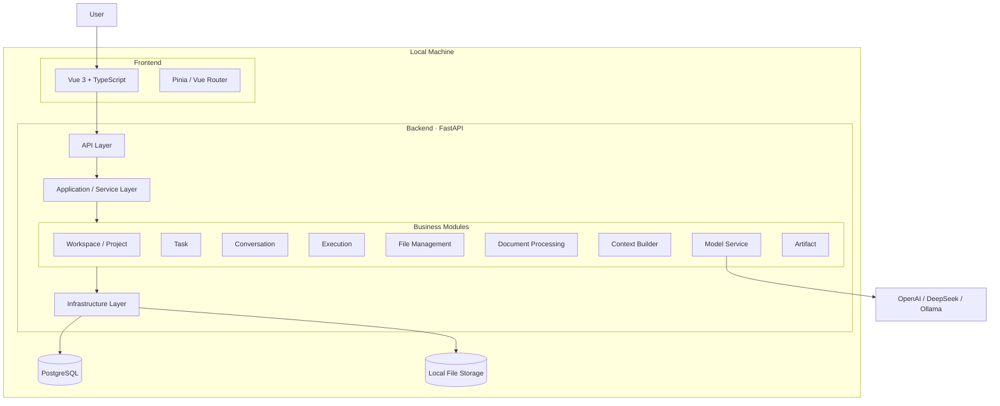
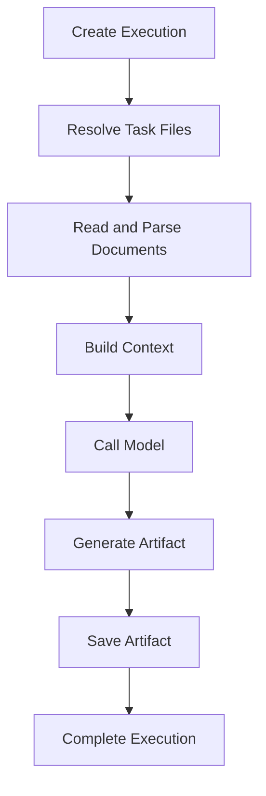
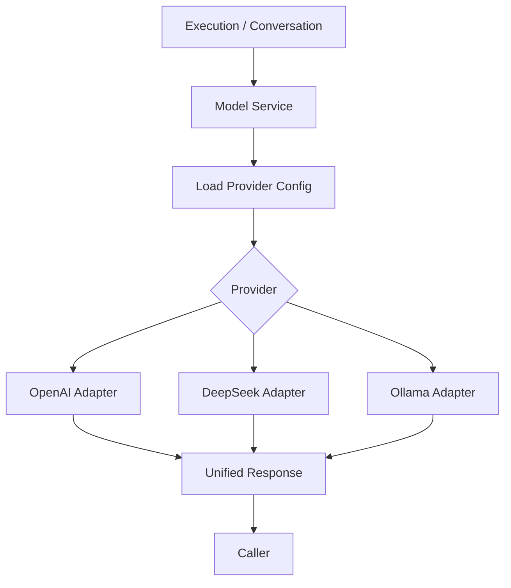
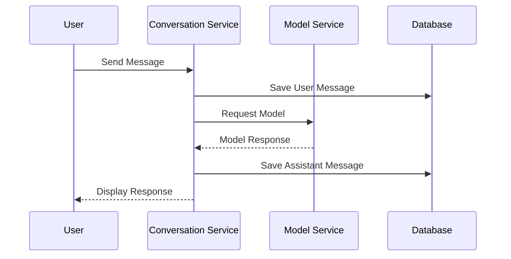
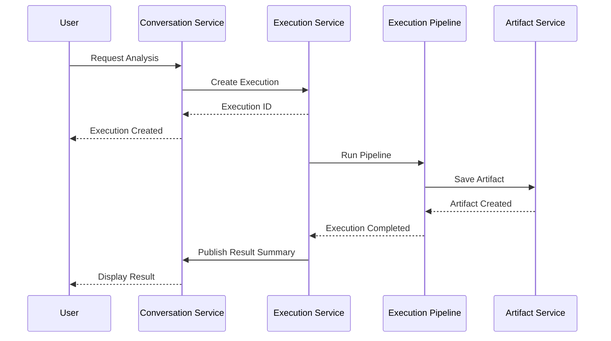

# Architecture Design

**项目名称：** mousehole  
**文档版本：** v0.1  
**文档定位：** 系统架构设计，定义系统模块、职责边界、依赖关系和核心业务流程。  
**关联文档：** `PRODUCT_SPEC.md`、`MVP_SPEC.md`、`DATA_MODEL.md`、`TECHNICAL_DECISIONS.md`

---

## 1. 设计目标

本文档定义 mousehole MVP 的整体系统架构。

主要解决以下问题：

- 系统由哪些模块组成？
- 每个模块负责什么？
- 模块之间如何协作？
- 用户操作如何转化为实际业务执行？
- 文件、上下文、模型和 Artifact 如何流转？
- Execution 如何调度、执行和记录？
- 如何保证模块具有足够的独立性，便于 AI Coding Agent 分模块开发？

架构设计以模块化单体为基础，优先保证职责清晰、依赖可控和开发效率。

MVP 不采用微服务，不引入不必要的分布式基础设施。

## 2. 整体架构

### 2.1 架构模式

采用 **模块化单体（Modular Monolith）**。

所有后端业务模块运行在同一个 FastAPI 应用中，但按照业务职责划分为相对独立的模块。

模块之间通过明确的服务接口协作，不允许随意访问其他模块的内部实现。

采用模块化单体的原因：

- MVP 是单用户本地应用。
- 当前业务规模不需要独立部署多个服务。
- 减少服务通信、部署和调试成本。
- 保留未来拆分独立服务的可能。
- 更适合由 AI Coding Agent 分模块实现和维护。

### 2.2 系统整体结构



### 2.3 前后端职责

**Frontend**

负责：

- 页面展示和用户交互。
- Workspace、Project、Task 管理界面。
- 文件上传和资料选择。
- Conversation 消息展示。
- Execution 状态及进度展示。
- Artifact 阅读与管理。
- 通过 REST API 和 SSE 与后端通信。

前端不直接访问数据库，也不直接调用模型供应商 API。

**Backend**

负责：

- 所有核心业务规则。
- 数据持久化和关联关系管理。
- 文件上传、存储及处理。
- Task 上下文解析和构建。
- 模型供应商适配。
- Execution 调度与执行。
- Artifact 生成和版本管理。
- 本地安全控制。

前端只负责表达用户意图和展示结果，业务规则由后端统一执行。

---

## 3. 后端模块划分

后端按照业务职责划分为以下模块。

### 3.1 Workspace / Project Module

负责长期工作环境和项目管理。

主要职责：

- Workspace 创建、查询和更新。
- Project 创建、查询和更新。
- Project 与 Workspace 的归属关系管理。
- Project 状态管理。
- Project 文件关联管理的业务协调。

不负责：

- Task 的实际执行。
- 文件内容解析。
- 模型调用。
- Artifact 生成。

### 3.2 Task Module

负责具体工作目标的管理。

主要职责：

- Task 创建、查询和更新。
- Task 与 Workspace、Project 的关联。
- Task 状态管理。
- Task 所属 Conversation 的关联。
- Task 模型选择信息的管理。
- Task 文件上下文配置的业务协调。

Task 是工作目标容器，不负责实际执行过程。

### 3.3 Conversation Module

负责用户与 AI 的持续交流记录。

主要职责：

- Conversation 创建和查询。
- Message 保存与读取。
- 消息顺序管理。
- 普通聊天请求协调。
- 普通模型调用结果保存。
- Execution 结果与 Conversation 的关联。

Conversation 不负责完整的复杂任务执行流程。

### 3.4 Execution Module

负责一次实际工作运行的完整生命周期。

这是后端最重要的业务模块之一。

主要职责：

- Execution 创建。
- Execution 状态管理。
- 执行调度。
- 执行步骤协调。
- 调用文件、上下文和模型模块。
- 处理执行错误。
- 保存执行记录。
- 协调 Artifact 生成。
- 完成或终止执行。

Execution Module 内部进一步划分：

| 子模块 | 职责 |
|---|---|
| Execution Service | 创建和管理 Execution |
| Execution Scheduler | 排队、调度和并发控制 |
| Execution Pipeline | 按确定顺序执行各阶段 |
| Execution Step Manager | 记录关键执行步骤 |
| Execution Recovery | 识别异常中断的执行 |

Execution 负责协调，不直接实现所有具体业务能力。

### 3.5 File Module

负责 Global Library 和文件引用关系管理。

主要职责：

- 文件上传。
- 文件元数据管理。
- 文件存储定位。
- 文件查询。
- Project 文件关联。
- Task 文件 include / exclude 配置。
- 文件删除和引用检查。
- 文件哈希管理。

File Module 只负责文件管理，不负责将 PDF 转换成模型可用的文本。

### 3.6 Document Processing Module

负责原始文件内容处理。

主要职责：

- 文件格式识别。
- PDF 文本提取。
- Markdown 读取。
- TXT 读取。
- 文本清洗。
- 文本分段。
- 文件处理错误反馈。

MVP 支持 PDF、Markdown 和 TXT。

该模块不负责文件元数据管理，也不直接调用模型。

未来可以在此扩展 OCR、复杂文档解析及其他格式处理能力。

### 3.7 Context Module

负责构建模型调用所需的上下文。

主要职责：

- 获取 Task 可用文件集合。
- 获取文件处理结果。
- 依据上下文预算组织文本。
- 控制输入长度。
- 对超出预算的内容进行分批处理。
- 必要时执行阶段性摘要与汇总。
- 输出结构化模型输入。
- 提供实际使用文件信息供 Execution 快照记录。

必须区分：

**Available Context：** Task 有权使用的资料。

**Actual Input Context：** 某次 Execution 实际读取并发送给模型的资料。

Project 文件继承只意味着 Task 可以使用这些文件，不意味着所有文件全文都会自动发送给模型。

MVP 采用直接检索和上下文组织，不实现完整 RAG。

未来 RAG 的检索结果可以作为 Context Module 的输入来源，而不需要重写 Execution 主体流程。

### 3.8 Model Module

负责统一模型调用。

主要职责：

- Provider 配置读取。
- Provider 可用性检查。
- 模型列表和模型选择校验。
- 模型请求构建。
- 模型调用。
- 流式输出。
- 响应格式统一。
- 超时和错误处理。

具体供应商通过 Adapter 实现：

```text
Model Service
    |
    +-- Provider Interface
    |       |
    |       +-- OpenAI Adapter
    |       +-- DeepSeek Adapter
    |       +-- Ollama Adapter
    |
    +-- Model Request
    +-- Model Response
    +-- Error Handling
```

Execution 和 Conversation 只依赖统一 Model Service，不应直接依赖某个供应商的 SDK。

Model Module 不负责：

- 文件读取。
- Task 管理。
- 上下文构建。
- Artifact 保存。

### 3.9 Artifact Module

负责成果保存和版本管理。

主要职责：

- Artifact 创建和查询。
- ArtifactSeries 管理。
- 版本号生成。
- 当前主要成果标记。
- Artifact 与 Execution 来源关联。
- 成果内容保存。
- 成果访问和读取。

新成果必须独立保存，不能覆盖历史版本。

版本号由 ArtifactSeries 内部管理，不与 Execution 序号混用。

### 3.10 Shared / Infrastructure Module

提供各业务模块共享的底层能力。

包括：

- 数据库连接和事务管理。
- 文件系统访问。
- 配置管理。
- 日志记录。
- 异常类型。
- 时间和 ID 工具。
- 事件发布与订阅。
- 安全相关工具。

Infrastructure 不负责具体业务决策。

---

## 4. 模块依赖与分层

### 4.1 分层结构

后端采用以下分层：

```text
API Layer
    |
    v
Service Layer
    |
    v
Repository Layer
    |
    v
Infrastructure
    |
    +-- PostgreSQL
    +-- Local File Storage
```

**API Layer**

负责 HTTP 请求接收、参数校验、身份及权限边界检查、响应组织。

不直接编写复杂业务逻辑。

**Service Layer**

负责业务规则和模块间协调。

例如 Execution Service 调用 File、Document Processing、Context、Model 和 Artifact 等模块。

**Repository Layer**

负责数据库读写和查询封装。

不承担跨模块业务流程编排。

**Infrastructure Layer**

负责数据库、文件系统、配置、日志等基础设施访问。

### 4.2 模块依赖原则

遵循以下约束：

1. API Layer 不直接访问 Repository。
2. 一个业务模块调用其他模块时，应通过其公开 Service 接口。
3. 不允许随意访问其他模块的内部类和私有函数。
4. 不允许多个模块分别实现同一套文件或模型调用逻辑。
5. 模块之间不得形成没有明确理由的循环依赖。
6. 基础设施实现不能反向依赖业务模块。
7. 跨模块事务由负责该业务流程的上层 Service 统一协调。

### 4.3 Execution 的协调权限

Execution Module 是复杂工作流程的主要协调者。

它可以调用其他模块提供的公开接口，但不应直接修改其他模块的内部状态。

例如：

```text
Execution Service
    |
    +-- File Service
    |
    +-- Document Processing Service
    |
    +-- Context Service
    |
    +-- Model Service
    |
    +-- Artifact Service
```

该设计使 Execution 能够组织完整流程，同时保持其他模块的独立性。

---

## 5. AI 执行架构

### 5.1 MVP 采用确定性工作流

MVP 不实现自主规划型 Agent。

采用程序控制流程、模型负责内容理解与生成的确定性工作流。



每个阶段由程序明确控制。

模型负责分析资料、理解任务目标和生成内容，但不能自行改变整个 Execution 的执行流程。

### 5.2 为什么不在 MVP 引入自主 Agent

当前核心目标是验证：

- 能否持续组织个人资料。
- 能否基于多份资料完成分析。
- 能否保存独立成果。
- 能否追踪历史执行。

这些能力不依赖复杂 Agent。

提前引入自主工具调用、动态规划和多 Agent 协作，会增加调试、权限和执行状态管理成本。

### 5.3 未来 Agent 扩展

未来可以在 Execution Pipeline 之上增加 Agent Execution Mode。

Agent 可以根据任务目标动态选择工具、检索资料和调整执行步骤。

但 Agent 必须遵循现有系统的权限、数据访问和执行记录机制。

未来 Agent 不应绕过 File、Model、Artifact 等模块直接访问底层资源。

---

## 6. Execution 生命周期

### 6.1 创建与调度

用户提交执行请求后：

1. API 接收请求。
2. Execution Service 校验 Task 和模型配置。
3. 创建 Execution 记录。
4. 状态设置为 Pending。
5. 提交数据库事务。
6. Scheduler 获取待执行记录。
7. 当存在可用执行槽位时，启动 Execution。

API 返回 Execution ID，不等待完整分析结束。

### 6.2 并发控制

MVP 支持有限并发。

默认最多同时运行 2 个 Execution。

```text
Execution Queue
    |
    +-- Execution A  Running
    |
    +-- Execution B  Running
    |
    +-- Execution C  Pending
    |
    +-- Execution D  Pending
```

完成一个执行后，Scheduler 从 Pending 队列中获取下一个任务。

MVP 不支持无限制并发。

并发上限通过统一配置管理，未来可以调整。

### 6.3 MVP 调度实现

采用轻量的进程内调度器，以 PostgreSQL 中的 Execution 状态作为持久化事实来源。

建议实现：

- 单个 Backend 实例。
- 一个统一 Scheduler。
- 有限并发执行槽位。
- 数据库持久化 Pending / Running 状态。
- FIFO 队列顺序。
- 启动时检查异常中断的 Execution。

执行任务本身通过独立的 Pipeline 运行。

不使用 FastAPI 的普通后台回调作为唯一的持久化任务队列，也不在 MVP 引入 Celery、RabbitMQ 等基础设施。

CPU 密集型文件处理不能长时间阻塞 FastAPI 事件循环，应通过适当的线程池或独立执行方式处理。

未来如果需要多进程、多实例、持久化重试队列或跨机器调度，再引入独立 Worker 和任务队列。

### 6.4 Execution 状态

主要状态：

```text
Pending
   |
   v
Running
   |
   +----> Completed
   |
   +----> Failed
   |
   +----> Cancelled
```

状态必须由 Execution Service 统一管理。

不允许前端直接修改 Execution 状态。

### 6.5 异常中断与恢复

应用启动时检查数据库中的执行记录。

对于上次运行时仍处于 Running 的 Execution：

- 不假设它仍然正常运行。
- 将其识别为异常中断。
- 记录必要错误信息。
- 统一标记为 Failed（不新增 Interrupted 状态），并在 error_message 中说明中断原因。
- 保留原有 Execution 和已保存成果的历史记录。

Pending 状态的任务可以继续由 Scheduler 调度。

MVP 不实现复杂的断点续跑。

---

## 7. Execution Pipeline 与阶段进度

### 7.1 Pipeline 阶段

每个 Execution 按以下阶段执行：

| 顺序 | 阶段 | 主要职责 |
|---|---|---|
| 1 | Resolve Files | 解析 Task 可用文件 |
| 2 | Parse Documents | 提取文档内容 |
| 3 | Build Context | 构建模型输入上下文 |
| 4 | Model Inference | 调用模型分析 |
| 5 | Generate Artifact | 组织成果内容 |
| 6 | Save Artifact | 保存成果并关联来源 |
| 7 | Complete | 完成执行并更新状态 |

### 7.2 阶段进度记录策略（MVP）

MVP 不持久化细粒度 ExecutionStep（P1）。

- 运行中的阶段进度通过 SSE 事件推送（`step.started` / `step.completed` / `step.failed`），前端据此展示 Pipeline 阶段进度。
- Execution 完成后，持久化状态、开始与结束时间、实际使用的模型、输入摘要、错误信息和结果摘要，足以支撑历史列表与结果查看。
- ExecutionStep 表结构可以预留，但不写入细粒度记录；完整步骤回放留待后续迭代。
- 详细调试日志与业务结果分开管理，日志不得包含密钥或完整文件内容。

### 7.3 结果提交

Artifact 应在内容生成完成并通过必要校验后正式保存。

文件型成果应避免在未完成时直接覆盖正式成果文件。

保存失败时，Execution 不得被标记为 Completed。

历史 Artifact 不得因新 Execution 失败而被删除或覆盖。

---

## 8. 文件处理与上下文构建流程

### 8.1 文件引用解析

Execution 启动后，首先通过 File Service 解析 Task 的可用文件集合。

规则遵循 `DATA_MODEL.md`：

```text
Task 可用文件
    =
(Project 文件 - Task 排除文件)
    +
Task 额外引用文件
```

Global Workspace 中直接创建的 Task 不继承 Project 文件。

### 8.2 文件解析

Document Processing 根据文件类型调用对应 Parser：

```text
Original File
     |
     v
Format Detection
     |
     +-- PDF Parser
     |
     +-- Markdown Parser
     |
     +-- TXT Parser
     |
     v
Extracted Text
     |
     v
Text Cleaning
     |
     v
Text Chunking
```

文件解析结果供 Context Service 使用。

文件解析失败时，应明确记录文件和错误原因，不允许静默忽略错误。

### 8.3 上下文构建

Context Service 负责：

1. 获取可用文件。
2. 读取文件解析结果。
3. 根据任务目标组织资料。
4. 计算模型上下文预算。
5. 根据预算分配内容。
6. 必要时分批处理。
7. 必要时进行阶段性摘要和汇总。
8. 输出最终模型输入。

MVP 不使用 Embedding、向量数据库或语义检索。

不允许无条件把所有文件全文拼接到 Prompt 中。

### 8.4 ExecutionFileSnapshot

Execution 应记录实际使用的文件快照，而不仅是 Task 当前引用的文件。

快照至少包含：

- File ID。
- 文件名快照。
- Content Hash。
- 文件版本信息（如果未来支持）。
- 来源类型。
- 实际使用时间。

快照记录应与实际读取的文件内容保持一致。

文件可用上下文与实际输入上下文必须分别处理。

---

## 9. Model Service 调用流程

### 9.1 模型选择

Task 创建时选择 Provider 和具体模型。

Model Service 根据 Task 当前模型配置获取对应 Adapter。

每次 Execution 记录实际使用的 Provider 和 Model。

Task 后续更换模型，不修改历史 Execution 的模型记录。

### 9.2 调用流程



### 9.3 统一接口

Provider Adapter 应提供统一调用接口。

至少覆盖：

- 普通模型调用。
- 流式模型调用。
- 参数映射。
- 结果解析。
- 超时处理。
- 错误归一化。

不同供应商的 API 差异由 Adapter 处理。

业务模块不应针对 OpenAI、DeepSeek 或 Ollama 编写重复的调用逻辑。

### 9.4 错误处理

| 错误 | 处理 |
|---|---|
| 网络超时 | 有限次数重试 |
| 临时服务错误 | 有限次数重试 |
| API Key 无效 | 直接失败并提示 |
| 模型不存在 | 直接失败并提示 |
| 上下文超限 | 尝试缩减或分批处理 |
| 不可恢复的 Provider 错误 | 终止执行并记录原因 |

重试必须有上限，不能无限循环。

---

## 10. Conversation 与 Execution 协作

### 10.1 普通聊天

普通聊天属于 Conversation 的持续交流，不要求每次都创建完整 Execution。



普通聊天可以通过 SSE 流式返回模型输出。

### 10.2 复杂任务

复杂分析任务由 Execution 负责实际工作。



### 10.3 设计原则

- Conversation 记录用户和 AI 的交流。
- Execution 记录实际工作过程。
- Task 是二者之间的业务归属容器。
- 一次 Conversation 可以触发多次 Execution。
- 一次 Execution 可以产生多个 Artifact。
- Execution 结果可以通过 Conversation 向用户反馈。

不能将 Conversation 和 Execution 合并成同一种记录。

---

## 11. SSE 事件通信

### 11.1 通信方式

采用 REST API + SSE。

REST API 负责普通业务请求和状态查询。

SSE 负责服务器向浏览器推送实时状态、步骤变化和模型流式输出。

### 11.2 Execution 事件流

每个 Execution 拥有独立事件流：

```text
GET /executions/{execution_id}/events
```

建议事件类型：

| 事件 | 含义 |
|---|---|
| execution.queued | 进入待执行队列 |
| execution.started | 开始执行 |
| step.started | Pipeline 阶段开始 |
| step.completed | Pipeline 阶段完成 |
| step.failed | Pipeline 阶段失败 |
| model.delta | 模型流式输出片段 |
| execution.completed | 执行完成 |
| execution.failed | 执行失败 |

事件至少包含：

- Execution ID。
- Event Type。
- Timestamp。
- 必要的业务数据。

### 11.3 事件与持久化

MVP 不引入独立事件总线或完整 Event Sourcing 架构。

事件主要通过进程内发布与订阅机制推送。

PostgreSQL 中的 Execution 状态、ExecutionFileSnapshot 和 Artifact 才是业务事实来源；ExecutionStep 属于 P1，不作为 MVP 的事实来源。

SSE 连接断开后：

1. 前端重新通过 REST API 获取最新 Execution 状态。
2. 重新订阅对应事件流。
3. 如果 Execution 已完成，则读取最终 Artifact 和 Conversation 结果。

MVP 不保证断线后完整重放所有历史 Token 片段。

最终生成内容必须独立保存，不能只存在 SSE 传输过程中。

### 11.4 SSE 的职责边界

SSE 是通信机制，不是 Execution 的执行引擎。

即使浏览器关闭或网络断开，后台 Execution 也不应因为客户端连接消失而自动停止。

---

## 12. 错误处理与系统一致性

### 12.1 错误分类

错误按照来源进行区分：

- API 请求错误。
- 数据库错误。
- 文件处理错误。
- 上下文构建错误。
- Provider 调用错误。
- Artifact 保存错误。
- Execution 内部错误。

错误应由发生模块产生，并交由上层模块决定业务处理方式。

### 12.2 关键原则

1. 不允许将失败伪装为成功。
2. 不允许静默跳过必要文件。
3. 不允许无限重试。
4. 不允许 Execution 失败时删除历史 Artifact。
5. 不允许前端直接修改执行状态。
6. 不允许模型调用错误泄露 API Key。
7. 发生异常时保留足够的诊断信息。

### 12.3 数据一致性

涉及多个模块的操作应明确事务边界。

例如：

- 创建 Execution 时，先持久化执行记录，再进入调度队列。
- 保存 Artifact 时，确保内容文件与数据库元数据保持一致。
- 生成新版本时，确保版本号唯一且递增。
- 文件删除前，检查历史引用关系。

跨文件系统与数据库的操作不能假设天然具有同一个数据库事务，应采用临时文件、失败清理和状态检查等方式降低不一致风险。

---

## 13. 建议代码组织

建议后端按照以下结构组织：

```text
backend/
└── app/
    ├── main.py
    │
    ├── api/
    │   └── v1/
    │       ├── workspaces.py
    │       ├── projects.py
    │       ├── tasks.py
    │       ├── conversations.py
    │       ├── executions.py
    │       ├── files.py
    │       ├── artifacts.py
    │       └── models.py
    │
    ├── modules/
    │   ├── workspace/
    │   ├── project/
    │   ├── task/
    │   ├── conversation/
    │   ├── execution/
    │   │   ├── service.py
    │   │   ├── scheduler.py
    │   │   ├── pipeline.py
    │   │   ├── steps.py
    │   │   └── recovery.py
    │   │
    │   ├── file/
    │   ├── document/
    │   ├── context/
    │   ├── model/
    │   │   └── providers/
    │   └── artifact/
    │
    ├── infrastructure/
    │   ├── database/
    │   ├── storage/
    │   ├── events/
    │   └── logging/
    │
    ├── shared/
    │   ├── config.py
    │   ├── exceptions.py
    │   └── types.py
    │
    └── tests/
```

实际代码目录可以根据开发需要微调，但不能破坏已经确定的模块职责和依赖规则。

前端也应采用相应的业务模块组织方式，避免所有页面和状态集中在单一目录中。

---

## 14. AI Coding Agent 开发边界

架构设计需要直接服务于后续 AI 辅助开发。

### 14.1 模块独立开发

每个模块应尽量具备：

- 明确的职责说明。
- 明确的输入和输出。
- 明确的公开 Service 接口。
- 明确的数据库访问边界。
- 独立的单元测试。
- 对其他模块的依赖说明。

Agent 可以在模块内部自主组织代码，但不能擅自改变模块对外契约。

### 14.2 开发任务划分

建议按照模块和依赖关系分配任务。

例如：

**File Module 开发任务：**

- 实现文件上传和元数据管理。
- 实现 Storage Key 访问。
- 实现 Project / Task 文件关联。
- 实现文件引用检查。
- 编写单元测试和 API 测试。

不应顺带修改 Execution Scheduler 或 Model Provider 的内部实现。

### 14.3 模块交付要求

一个模块完成时，Agent 至少提交：

1. 实现内容。
2. 对外接口说明。
3. 关键实现解释。
4. 自动化测试。
5. 测试结果。
6. 已知限制。
7. 对其他模块的依赖或变更说明。

模块通过审查后，才能作为后续模块开发的稳定依赖。

### 14.4 架构变更

Agent 可以提出架构优化建议，但不能未经批准直接：

- 更换技术栈。
- 修改核心实体关系。
- 调整模块职责。
- 增加大型基础设施。
- 破坏模块接口。
- 改变已确认的产品需求。

---

## 15. MVP 架构范围与未来扩展

### 15.1 MVP 必须实现

- 模块化单体后端。
- 明确的前后端职责边界。
- Workspace、Project、Task 管理模块。
- Conversation 与 Execution 分离。
- File 与 Document Processing 分离。
- 独立 Context Service。
- 独立 Model Service 和 Provider Adapter。
- 独立 Artifact Service。
- 确定性 Execution Pipeline。
- 轻量 Execution Scheduler。
- 默认最多两个并发 Execution。
- Execution 状态持久化与阶段事件推送（ExecutionStep 细粒度记录为 P1）。
- REST API + SSE。
- 基本错误处理和异常恢复。
- 模块级自动化测试。

### 15.2 MVP 不实现

- 微服务。
- 分布式任务队列。
- 多 Agent 协作。
- 自主规划型 Agent。
- 完整 RAG。
- Embedding 和向量检索。
- 完整 Event Sourcing。
- 独立消息中间件。
- WebSocket。
- 多实例调度。
- 复杂断点续跑。

### 15.3 未来扩展方向

在现有模块边界上逐步扩展：

- Agent Execution Mode。
- RAG 检索模块。
- Skill、Workflow 和 Tool 管理。
- MCP 集成。
- 更成熟的 Worker 和任务队列。
- 更多模型 Provider。
- 更多文档解析能力。
- 更丰富的 Artifact 类型。
- IDE、GitHub 等外部工具连接。

---

## 16. 与其他设计文档的关系

本文档依赖并落实以下设计：

| 文档 | 在架构中的作用 |
|---|---|
| PRODUCT_SPEC.md | 确定产品定位和长期目标 |
| MVP_SPEC.md | 确定第一版业务范围 |
| DATA_MODEL.md | 确定实体和数据关系 |
| TECHNICAL_DECISIONS.md | 确定技术栈和工程约束 |
| UI_SPEC.md | 确定前端界面和交互设计 |
| DEVELOPMENT_PLAN.md | 确定模块开发顺序与交付方式 |

如果实际实现发现架构存在问题，应提出变更建议，并同步更新相关设计文档。

**架构的目的不是限制实现，而是让不同模块能够在明确边界内独立演进。**

---

## 17. Phase 3 实装补充：Skill、受控工具与消息追溯

### 17.1 新增模块与职责

| 模块 | 职责 |
|---|---|
| skill | Skill / SkillFile / TaskSkill 数据与服务；内置 seed；解析 Skill 供 Execution 使用 |
| conversation/tools | 受控工具 allowlist：read_task_files / read_task_file / save_artifact / create_execution；_wrap 工厂生成 TOOLS_SPEC；tool_prompt() 动态渲染系统提示 |
| conversation/chat_context | Chat 的文件/Skill 资料上下文：预算内节选、最近更新优先、显式列出清单 |

### 17.2 Chat 数据流

1. 消息进入 → 解析 Skill（可选）→ 构建文件/Skill 资料上下文（预算 12k tokens，单文件 8k 字符，按 updated_at 新→旧）；
2. 工具 pre-pass（非流式，最多 4 轮）：模型调用工具 → 后端 allowlist 执行 → 结果回灌；
3. 最终回答：不再带 tools，若模型泄漏 DSML/工具文本则重试一次，仍失败显式报错；
4. 持久化 Message（含 usage 与 metadata）；Artifact 记录 `source_type=chat` + `source_message_id`。

### 17.3 Execution 数据流（保持原架构）

- Skill 解析 → Pipeline（解析文件 + Skill 资料 → 构建上下文 → 模型 → 保存 Artifact）→ Scheduler 状态机；
- Execution 仍是内部工程实体，UI 不展示 Execution ID，仅以 Chat 内工作进度呈现。

### 17.4 边界与一致性

- 工具只能操作当前 Task 的可用文件/Artifact/Execution；无任意文件系统、Shell、外部写；
- Execution 状态只由 Execution Service 修改；
- 普通对话不创建 Execution；Artifact 独立于 Execution。

### 17.5 验证

- 后端 97 个自动化测试通过；前端构建通过；真实模型端到端覆盖分析、保存成果、工具读取、大文件分页与失败路径。

