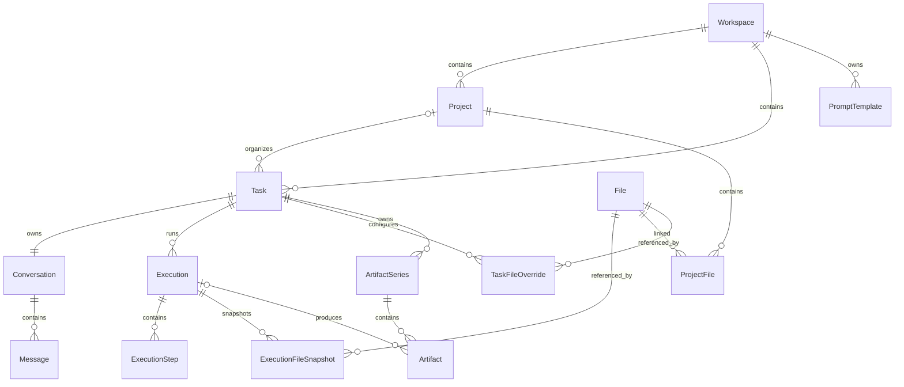

# DATA_MODEL.md

> mousehole 核心数据模型设计

**文档版本：** v0.1 
**文档定位：** 定义 mousehole 核心实体、实体关系、字段和数据约束 
**上游文档：** PRODUCT_SPEC.md、MVP_SPEC.md 
**下游文档：** TECHNICAL_DECISIONS.md、ARCHITECTURE.md 

---

## 1. 设计目标

DATA_MODEL 定义 mousehole 的核心业务实体及其关系，为后续数据库设计、后端接口和业务逻辑提供统一的数据结构基础。

本阶段关注逻辑数据模型，不提前锁定具体数据库、ORM 或 SQL 方言。

### 1.1 核心设计原则

1. **工作组织与执行过程分离**：Workspace、Project、Task 负责组织工作；Execution 负责记录实际执行。
2. **对话与执行分离**：Conversation 记录用户与 AI 的交流；Execution 记录系统实际完成工作的过程。
3. **原始文件与成果分离**：File 保存用户提供的原始资料；Artifact 保存工作产生的成果。
4. **文件存储与文件引用分离**：文件只存储一份，通过关联关系被多个 Project 或 Task 使用。
5. **上下文继承与实际使用分离**：Task 可以继承 Project 的可用文件，但不意味着所有文件都会被发送给模型。
6. **执行过程可追溯**：Execution 记录实际使用的文件、模型、执行状态和结果。
7. **成果独立保存**：Artifact 不依赖 Conversation 消息存在，每次新生成的成果独立保存，不覆盖历史成果。
8. **渐进式扩展**：MVP 保持模型简单，同时为 RAG、复杂执行流程、能力库和版本管理预留扩展空间。

---

## 2. 核心实体概览

核心实体分为四组。

| 分组 | 实体 | 作用 |
|---|---|---|
| 工作组织层 | Workspace | 长期工作空间 |
| 工作组织层 | Project | 长期项目 |
| 工作组织层 | Task | 具体工作目标 |
| 交流与执行层 | Conversation | Task 下的持续交流记录 |
| 交流与执行层 | Message | 对话消息 |
| 交流与执行层 | Execution | 一次实际执行过程 |
| 交流与执行层 | ExecutionStep | 执行过程中的步骤记录 |
| 资源与成果层 | File | 原始用户文件 |
| 资源与成果层 | ProjectFile | Project 与 File 的关联 |
| 资源与成果层 | TaskFileOverride | Task 对继承文件的额外引用或排除 |
| 资源与成果层 | ExecutionFileSnapshot | Execution 实际使用文件的快照 |
| 资源与成果层 | ArtifactSeries | 同一类成果的版本系列 |
| 资源与成果层 | Artifact | 独立保存的工作成果 |
| 能力配置层 | PromptTemplate | 可复用的 Prompt 模板 |

其中，ExecutionStep 和 ExecutionFileSnapshot 是为了记录执行细节而设置的辅助实体。MVP 可以采用简单实现，不必过早构建复杂的执行编排系统。

---

## 3. 实体关系总览

### 3.1 核心关系图



### 3.2 关键关系说明

- 一个 Workspace 可以包含多个 Project 和 Task。
- 一个 Project 必须属于一个 Workspace。
- 一个 Task 必须属于一个 Workspace，可以选择关联一个 Project。
- 如果 Task 关联 Project，则两者必须属于同一个 Workspace。
- 一个 Task 在 MVP 中拥有一个主 Conversation。
- 一个 Task 可以有多次 Execution。
- 一个 Execution 可以包含多个 ExecutionStep。
- 一个 File 可以被多个 Project 和 Task 引用。
- ProjectFile 负责记录 Project 与 File 的关联。
- TaskFileOverride 负责记录 Task 对继承文件的额外引用和排除。
- ExecutionFileSnapshot 记录某次执行实际使用的文件及其版本信息。
- 一个 Task 可以拥有多个 ArtifactSeries。
- 一个 ArtifactSeries 可以包含多个 Artifact 版本。
- 一个 Execution 可以生成零个或多个 Artifact。
- Artifact 可以关联来源 Execution；来源允许为空，为未来手动创建或导入成果预留空间。

---

## 4. 工作组织层

### 4.1 Workspace

**定义：** 用户长期使用的工作空间，是所有 Project、Task 和通用资料的组织环境。

MVP 以单用户为前提，但仍然保留 Workspace 实体，避免未来扩展时需要重构所有实体关系。

| 字段 | 类型（逻辑） | 说明 |
|---|---|---|
| id | ID | 主键 |
| name | String | 工作空间名称 |
| description | Text | 描述，可为空 |
| created_at | DateTime | 创建时间 |
| updated_at | DateTime | 更新时间 |

约束：

- 用户至少拥有一个 Workspace。
- Workspace 可以包含多个 Project。
- Workspace 可以直接包含 Task。
- Workspace 不直接拥有 File 的物理存储，File 统一进入 Global Library。

MVP 默认创建一个用户工作空间，不实现多用户或多租户机制。

### 4.2 Project

**定义：** 围绕一个长期主题或目标组织工作的单元。

例如：Agent Learning、mousehole Development。

| 字段 | 类型（逻辑） | 说明 |
|---|---|---|
| id | ID | 主键 |
| workspace_id | ID | 所属 Workspace |
| name | String | 项目名称 |
| description | Text | 项目描述 |
| status | Enum | active / archived |
| created_at | DateTime | 创建时间 |
| updated_at | DateTime | 更新时间 |

约束：

- Project 必须属于一个 Workspace。
- Project 可以关联多个 File。
- Project 可以拥有多个 Task。
- Project 归档不等于删除其下的 Task、File 或 Artifact。
- Project 的文件上下文可以被其 Task 默认继承。

### 4.3 Task

**定义：** 用户希望 mousehole 完成的一项具体工作，是工作目标、对话和执行过程的组织容器。

例如：分析 AgentOne 的整体架构、比较两个技术方案、整理某一组学习资料。

| 字段 | 类型（逻辑） | 说明 |
|---|---|---|
| id | ID | 主键 |
| workspace_id | ID | 所属 Workspace |
| project_id | ID / Nullable | 关联 Project，可为空 |
| title | String | 任务标题 |
| description | Text | 任务目标或补充说明 |
| status | Enum | active / completed / archived |
| created_at | DateTime | 创建时间 |
| updated_at | DateTime | 更新时间 |

约束：

- Task 必须属于一个 Workspace。
- Task 可以不关联 Project，直接属于 Workspace。
- Task 如果关联 Project，则必须与 Project 属于同一个 Workspace。
- Task 可以拥有一个主 Conversation。
- Task 可以拥有多次 Execution。
- Task 可以拥有多个 ArtifactSeries。

Task 是工作目标的容器，不等同于一次对话或一次执行。

---

## 5. 交流与执行层

### 5.1 Conversation

**定义：** 用户与 AI 围绕一个 Task 持续交流的记录。

Conversation 负责保存讨论上下文，不承担完整执行日志和成果存储职责。

| 字段 | 类型（逻辑） | 说明 |
|---|---|---|
| id | ID | 主键 |
| task_id | ID | 所属 Task，唯一 |
| created_at | DateTime | 创建时间 |
| updated_at | DateTime | 更新时间 |

约束：

- MVP 中一个 Task 对应一个主 Conversation。
- Conversation 必须属于一个 Task。
- Conversation 与 Execution 独立存在。
- 未来可以扩展为一个 Task 拥有多个 Conversation 或对话分支。

### 5.2 Message

**定义：** Conversation 中的一条消息。

| 字段 | 类型（逻辑） | 说明 |
|---|---|---|
| id | ID | 主键 |
| conversation_id | ID | 所属 Conversation |
| role | Enum | system / user / assistant / tool |
| content | Text | 消息内容 |
| sequence | Integer | 消息顺序 |
| created_at | DateTime | 创建时间 |

约束：

- Message 必须属于一个 Conversation。
- 消息顺序应保持稳定。
- MVP 以文本消息为主。
- 后续可以扩展多模态内容、附件引用、工具调用展示等。

注意：Message 中可以出现 AI 对执行过程的解释，但不能以 Message 代替 Execution 的实际运行记录。

### 5.3 Execution

**定义：** 系统围绕一个 Task 实际完成工作的一次运行过程。

一次 Execution 可以包含多个步骤、多个模型调用以及文件处理操作。

例如：

1. 读取 Task 可用文件。
2. 提取 PDF 文本。
3. 对文本进行分段和上下文组织。
4. 调用模型进行分析。
5. 整理分析结果。
6. 生成 Artifact。

| 字段 | 类型（逻辑） | 说明 |
|---|---|---|
| id | ID | 主键 |
| task_id | ID | 所属 Task |
| sequence | Integer | Task 内执行序号 |
| status | Enum | pending / running / succeeded / failed / cancelled |
| model_provider | String | 模型服务提供方 |
| model_name | String | 使用的模型名称 |
| started_at | DateTime | 开始时间 |
| completed_at | DateTime / Nullable | 结束时间 |
| input_summary | Text | 本次执行输入或目标摘要 |
| error_message | Text / Nullable | 失败原因 |
| created_at | DateTime | 创建时间 |

约束：

- Execution 必须属于一个 Task。
- 一个 Task 可以有多次 Execution。
- sequence 在同一个 Task 内唯一且递增。
- Execution 完成后应保留必要的执行信息。
- Execution 不一定生成 Artifact。
- 一次 Execution 可以产生多个 Artifact。
- 普通对话不一定产生完整 Execution。

模型配置和调用参数可以在未来扩展为独立的执行配置或模型调用记录。MVP 先保留能够追溯模型提供方和模型名称的字段。

### 5.4 ExecutionStep

**定义：** Execution 内部的一项执行步骤，用于记录实际工作过程。

| 字段 | 类型（逻辑） | 说明 |
|---|---|---|
| id | ID | 主键 |
| execution_id | ID | 所属 Execution |
| sequence | Integer | 步骤顺序 |
| step_type | String | 步骤类型 |
| name | String | 步骤名称 |
| status | Enum | pending / running / succeeded / failed |
| input_summary | Text / Nullable | 输入摘要 |
| output_summary | Text / Nullable | 输出摘要 |
| started_at | DateTime / Nullable | 开始时间 |
| completed_at | DateTime / Nullable | 结束时间 |
| error_message | Text / Nullable | 错误信息 |

MVP 的步骤类型可以包括：

- file_loading
- text_extraction
- context_building
- model_call
- artifact_generation

约束：

- ExecutionStep 必须属于一个 Execution。
- sequence 在同一次 Execution 内唯一。
- 不要求 MVP 实现复杂的图执行引擎。
- 步骤记录应以可追溯为目的，不应为了记录而记录无意义的内部细节。

---

## 6. 资源层：File 与文件引用

### 6.1 File

**定义：** 用户上传到 Global Library 的原始文件。

File 负责记录文件元数据和物理存储位置，不直接决定文件属于哪个 Project 或 Task。

| 字段 | 类型（逻辑） | 说明 |
|---|---|---|
| id | ID | 主键 |
| filename | String | 原始文件名 |
| storage_key | String | 实际存储位置标识 |
| file_type | String | 文件类型或扩展名 |
| mime_type | String | MIME 类型 |
| size | Integer | 文件大小 |
| content_hash | String | 文件内容哈希 |
| status | Enum | active / deleted |
| created_at | DateTime | 上传时间 |
| updated_at | DateTime | 更新时间 |

MVP 支持：

- PDF
- Markdown
- TXT

暂不支持：

- Word
- Excel
- PowerPoint
- OCR
- 音视频

约束：

- File 在 Global Library 中独立存在。
- 同一个 File 可以被多个 Project 和 Task 引用。
- 上传文件不意味着所有 Task 都自动读取它。
- 文件的实际存储路径不应直接暴露为业务实体 ID。
- content_hash 用于识别文件内容，辅助执行快照和后续文件版本追溯。

### 6.2 ProjectFile

**定义：** Project 与 File 之间的关联记录。

| 字段 | 类型（逻辑） | 说明 |
|---|---|---|
| id | ID | 主键 |
| project_id | ID | 所属 Project |
| file_id | ID | 关联 File |
| added_at | DateTime | 加入时间 |

约束：

- project_id 与 file_id 组合唯一。
- File 物理存储不因 Project 关联而复制。
- 删除 ProjectFile 只解除关联，不删除 File。

### 6.3 TaskFileOverride

**定义：** Task 对 Project 继承文件上下文的调整记录。

采用动态继承机制：Task 在执行时读取所属 Project 当前的可用文件集合，再结合自身的额外引用和排除规则得到最终可用上下文。

| 字段 | 类型（逻辑） | 说明 |
|---|---|---|
| id | ID | 主键 |
| task_id | ID | 所属 Task |
| file_id | ID | 关联 File |
| action | Enum | include / exclude |
| created_at | DateTime | 创建时间 |

规则：

1. Project 内创建的 Task 默认继承 Project 的全部可用文件。
2. Task 可以额外引用 Global Library 中的文件。
3. Task 可以排除不需要的继承文件。
4. Global Workspace 中直接创建的 Task 不继承任何 Project 文件。
5. 同一个 Task 对同一个 File 最多存在一条有效 override。
6. include 表示额外加入文件；exclude 表示排除继承文件。
7. 如果 File 已经属于 Project，Task 不需要重复建立 include 记录。
8. 如果 Task 后续关联的 Project 发生变化，应重新计算可用上下文，并清理或校验不再适用的 override。

**可用文件集合的逻辑计算：**

对于关联 Project 的 Task：

`可用文件 = (Project 文件 - Task 排除文件) + Task 额外引用文件`

对于不关联 Project 的 Task：

`可用文件 = Task 额外引用文件`

注意：可用文件集合不等于实际模型输入文件集合。实际读取哪些文件由 Execution 根据任务目标、上下文预算和处理策略决定。

### 6.4 ExecutionFileSnapshot

**定义：** 某次 Execution 实际使用的文件快照。

这是 mousehole 可追溯执行过程的重要基础。

| 字段 | 类型（逻辑） | 说明 |
|---|---|---|
| id | ID | 主键 |
| execution_id | ID | 所属 Execution |
| file_id | ID | 来源 File |
| filename_snapshot | String | 执行时文件名 |
| content_hash_snapshot | String | 执行时文件内容哈希 |
| file_version_snapshot | String / Nullable | 文件版本标识，可选 |
| source_type | Enum | project_inherited / task_added |
| used_at | DateTime | 实际使用时间 |

约束：

- 仅记录本次 Execution 实际读取或使用的文件。
- 同一个 File 在一次 Execution 中原则上只记录一份有效快照。
- Execution 完成后，快照不随 File 后续变化而改变。
- 历史执行记录不能仅依赖当前 File 元数据来还原当时的使用情况。

MVP 至少记录文件 ID、文件名和内容哈希。

如果未来需要完整重现历史执行，还应保留当时的文件内容版本或不可变文件副本。仅保存哈希只能验证内容是否一致，不能还原已经被覆盖或删除的原始内容。

---

## 7. 成果层：Artifact

### 7.1 Artifact 的定义

**Artifact 是一次工作执行后产生的、可以独立保存和复用的成果。**

它不等同于聊天消息，也不一定是一个物理文件。

例如：

- Markdown 分析报告
- 技术方案文档
- 数据分析结果
- 架构分析结论
- 后续扩展的图表、代码或其他结构化成果

Artifact 由 Execution 产生，通过 Execution 追溯其来源，并通过所属 Task 进入对应的 Project 或 Workspace。

### 7.2 ArtifactSeries

**定义：** 同一个 Task 下，一组具有相同成果主题或用途的 Artifact 版本集合。

引入 ArtifactSeries 是为了避免把所有成果放在 Task 级别统一编号。

例如，一个 Task 可以同时拥有：

- 架构分析报告系列：v1、v2、v3
- 技术选型对比系列：v1、v2
- 学习总结系列：v1

| 字段 | 类型（逻辑） | 说明 |
|---|---|---|
| id | ID | 主键 |
| task_id | ID | 所属 Task |
| title | String | 成果系列名称 |
| description | Text / Nullable | 系列说明 |
| current_artifact_id | ID / Nullable | 当前主要成果 |
| created_at | DateTime | 创建时间 |
| updated_at | DateTime | 更新时间 |

约束：

- ArtifactSeries 必须属于一个 Task。
- 一个 Task 可以拥有多个 ArtifactSeries。
- current_artifact_id 必须指向同一系列中的 Artifact。
- 当前主要成果可以为空。
- 系列名称用于识别成果主题，不作为物理文件名。

### 7.3 Artifact

**定义：** 某个成果系列中的一份独立成果。

| 字段 | 类型（逻辑） | 说明 |
|---|---|---|
| id | ID | 主键 |
| series_id | ID | 所属 ArtifactSeries |
| source_execution_id | ID / Nullable | 来源 Execution |
| version | Integer | 系列内版本号 |
| title | String | 成果标题 |
| content_type | String | 成果内容类型 |
| content | Text / Nullable | 成果内容；也可以由存储引用代替 |
| storage_key | String / Nullable | 外部或本地存储位置，可选 |
| created_at | DateTime | 创建时间 |

约束：

1. Artifact 必须属于一个 ArtifactSeries。
2. Artifact 的版本号在同一系列内唯一且递增。
3. Artifact 可以关联一个来源 Execution；允许为空，为未来手动创建或导入成果预留。
4. 一个 Execution 可以生成多个 Artifact。
5. 一个 Execution 也可以不生成 Artifact。
6. 新生成的 Artifact 不得自动覆盖已有 Artifact。
7. Artifact 的版本号是成果系列内的版本，不等于 Execution 序号。
8. 文件名不承担版本管理职责，版本信息由数据模型管理。
9. 当前主要成果由 ArtifactSeries.current_artifact_id 指向。

**示例：**

| Execution | Artifact 系列 | Artifact 版本 |
|---|---|---|
| Execution #001 | 架构分析报告 | v1 |
| Execution #002 | 架构分析报告 | v2 |
| Execution #003 | 架构分析报告 | v3 |
| Execution #003 | 技术选型对比 | v1 |

这里需要区分：

- Execution 序号：Task 的第几次执行。
- Artifact 版本号：某个成果系列的第几个版本。

一次执行可以生成多个不同系列的成果，也可能不产生新成果。

### 7.4 Artifact 的展示与追溯

UI 应当让用户直观看到成果与执行之间的关系。

每份 Artifact 至少展示：

- 成果名称
- 版本号
- 来源 Execution 编号
- 创建时间

例如：

```text
架构分析报告

v1
Execution #001
2026-11-18 19:30

v2
Execution #002
2026-11-19 10:20

v3  · 当前主要成果
Execution #003
2026-11-19 15:40
```

以上属于 UI 层展示要求，具体布局在 UI_SPEC.md 中定义。

### 7.5 MVP 范围

MVP 实现：

- Artifact 独立保存。
- 成果系列及其版本号。
- 来源 Execution 关联。
- 创建时间。
- 当前主要成果标记。
- 从 Task 或 Project 页面查看成果。

暂不实现：

- 版本差异比较。
- 版本回滚。
- 分支式成果演进。
- 完整编辑历史。
- 多人协作与冲突合并。

---

## 8. 能力配置层

### 8.1 PromptTemplate

**定义：** 可复用的 Prompt 模板，为未来的个人能力库提供基础。

MVP 只实现基础 Prompt 模板，不实现完整的 Skill、Workflow、Tool 或 MCP 能力管理。

| 字段 | 类型（逻辑） | 说明 |
|---|---|---|
| id | ID | 主键 |
| workspace_id | ID | 所属 Workspace |
| name | String | 模板名称 |
| description | Text / Nullable | 模板说明 |
| content | Text | Prompt 模板内容 |
| created_at | DateTime | 创建时间 |
| updated_at | DateTime | 更新时间 |

约束：

- PromptTemplate 属于 Workspace。
- 一个 Workspace 可以拥有多个 PromptTemplate。
- 模板可以在未来被多个 Task 使用。
- PromptTemplate 不等同于 Skill，也不负责执行流程。
- 未来可以增加变量定义、分类、版本、来源和导入信息。

---

## 9. 生命周期与数据完整性

### 9.1 删除规则

mousehole 应避免用户删除某个实体时意外破坏其他实体的历史数据。

| 实体 | 建议规则 |
|---|---|
| Workspace | MVP 不提供直接物理删除入口 |
| Project | 支持归档；删除前检查关联 |
| Task | 支持归档；历史 Execution 和 Artifact 保留 |
| Conversation | 随 Task 生命周期管理 |
| Message | 不单独删除历史消息，后续可扩展 |
| File | 有引用时禁止直接物理删除 |
| ProjectFile | 可删除关联，不删除 File |
| TaskFileOverride | 可删除规则记录 |
| Execution | 保留历史记录，不允许普通用户直接删除 |
| ExecutionStep | 随 Execution 保留 |
| ExecutionFileSnapshot | 随 Execution 保留 |
| ArtifactSeries | 有成果时不直接删除 |
| Artifact | 保留历史成果，未来可增加归档状态 |
| PromptTemplate | 支持删除或归档，具体规则后续确定 |

MVP 文件删除策略：

1. 用户请求删除 File 时，先检查是否仍被 Project 或 Task 引用。
2. 存在引用时，提示用户先解除关联。
3. 如果历史 Execution 使用过该文件，则不能破坏历史快照记录。
4. 采用软删除或受控删除，避免直接删除底层文件导致历史记录失效。

### 9.2 归档与删除的区别

归档表示不再作为当前活跃工作对象，但保留其历史信息。

删除表示用户希望移除对象及其相关数据，需要遵循引用关系和历史数据保护规则。

MVP 优先提供归档能力，不急于实现复杂的级联删除机制。

### 9.3 时间字段

所有核心实体的创建时间和更新时间应统一使用明确的时间标准保存。

建议数据库内部统一使用 UTC 时间，前端根据用户本地时区展示。

Execution 应分别记录开始时间和完成时间，便于后续统计执行耗时。

### 9.4 ID 与唯一性

- 所有核心实体使用独立主键。
- 不使用文件名、标题或显示名称作为实体唯一标识。
- Task 内 Execution 的 sequence 唯一。
- Conversation 的 task_id 在 MVP 中唯一。
- ProjectFile 的 project_id + file_id 唯一。
- ArtifactSeries 内 Artifact 的 version 唯一。
- 关联实体必须保证引用目标存在。

### 9.5 事务与一致性

以下操作应保证数据关系一致：

- 创建 Project 时，必须关联有效 Workspace。
- 创建关联 Project 的 Task 时，必须校验 Workspace 一致性。
- 创建 Execution 时，应保证所属 Task 存在。
- 创建 Artifact 时，应保证所属 ArtifactSeries 存在。
- 更新 ArtifactSeries.current_artifact_id 时，应保证目标 Artifact 属于该系列。
- 记录 ExecutionFileSnapshot 时，应保证对应 Execution 存在，并记录实际使用的文件信息。

---

## 10. 典型数据流

### 10.1 创建 Project 与上传文件

1. 用户进入 Workspace。
2. 创建 Project。
3. 上传 PDF、Markdown 或 TXT 文件。
4. File 进入 Global Library。
5. 创建 ProjectFile 关联。
6. Project 获得该文件的可用上下文。

### 10.2 创建 Task 与继承上下文

1. 用户在 Project 内创建 Task。
2. Task 保存 workspace_id 和 project_id。
3. Task 默认继承 Project 的全部可用文件。
4. 用户可以额外引用 Global Library 文件。
5. 用户可以排除不需要的继承文件。
6. 系统根据关联关系计算 Task 的可用文件集合。

Task 不需要复制 Project 文件，也不需要在创建时固化文件列表。

### 10.3 执行 Task

1. 用户向 Conversation 提出任务要求。
2. 系统根据 Task 目标获取可用文件集合。
3. 系统选择实际需要使用的文件。
4. 系统读取和处理文件。
5. 系统组织上下文并调用模型。
6. 系统记录 Execution 和 ExecutionStep。
7. 系统记录实际使用文件的 ExecutionFileSnapshot。
8. 执行成功后，根据任务需要生成 Artifact。
9. Conversation 保存用户与 AI 的交流结果。
10. Task 页面可以查看 Execution 历史和 Artifact。

### 10.4 文件更新与历史执行

假设 File A 在第一次执行后被用户更新。

- 新执行可以读取更新后的内容。
- 新执行记录新的 content_hash_snapshot。
- 历史 Execution 保留原来的文件哈希和文件元数据快照。
- 历史 Execution 不应被新文件内容改变。

MVP 通过内容哈希实现基础追溯。若未来要求完全重现历史执行，需要增加不可变文件版本或内容副本机制。

---

## 11. MVP 实现优先级

| 优先级 | 实体或功能 | 说明 |
|---|---|---|
| P0 | Workspace | 基础工作空间 |
| P0 | Project | 项目组织 |
| P0 | Task | 工作目标 |
| P0 | Conversation / Message | 基础交流记录 |
| P0 | Execution | 执行记录 |
| P0 | File | 文件库 |
| P0 | ProjectFile | 项目文件关联 |
| P0 | TaskFileOverride | 文件继承、额外引用和排除 |
| P0 | ExecutionFileSnapshot | 执行文件快照 |
| P0 | ArtifactSeries / Artifact | 成果独立保存和版本 |
| P1 | ExecutionStep | 更详细的执行过程展示 |
| P1 | PromptTemplate | 基础 Prompt 模板管理 |

说明：

- P0 表示核心闭环需要的能力。
- P1 表示可以在核心闭环完成后实现的能力。
- ExecutionStep 的数据结构可以提前预留，但 MVP 初期不必实现复杂步骤追踪。
- PromptTemplate 可以后续加入，不影响多文档分析场景的核心闭环。

---

## 12. 暂不纳入本阶段的模型

以下能力不属于当前 MVP 数据模型的必需部分：

- 多用户、组织和权限体系。
- 完整 Skill 管理系统。
- Workflow 图定义和执行引擎。
- MCP Server / Tool 注册中心。
- RAG 向量索引与检索实体。
- Agent 多角色协作。
- 完整文件版本控制。
- Artifact 差异比较与回滚。
- 多 Conversation 分支。
- 多人协作与共享权限。

这些能力未来可以基于当前实体关系扩展，不需要在 MVP 阶段提前实现。

---

## 13. 后续设计事项

本文件定义的是逻辑数据模型，后续还需要在其他设计文档中确定：

### TECHNICAL_DECISIONS.md

- 数据库选型。
- 文件存储方式。
- 后端技术栈。
- ORM 与数据库迁移方案。
- 模型 API 接入方式。
- 文件解析方案。

### ARCHITECTURE.md

- 前后端整体架构。
- 文件上传和解析流程。
- Execution 执行流程。
- 模型调用与上下文管理。
- Artifact 生成和存储流程。
- 后续 RAG 扩展位置。

### UI_SPEC.md

- Workspace 与 Project 页面结构。
- Task 详情页。
- Conversation 与 Execution 的展示方式。
- Execution 历史。
- Artifact 版本与来源展示。
- Global File Library。

---

## 14. 设计总结

mousehole 的核心数据模型围绕以下关系展开：

**Workspace → Project → Task → Execution → Artifact**

同时由 Conversation 承载持续交流，由 File Library 提供资料，由 PromptTemplate 提供基础可复用能力。

其中最重要的设计边界是：

- Task 表示工作目标。
- Conversation 表示交流过程。
- Execution 表示实际执行过程。
- File 表示原始资料。
- Artifact 表示执行产生的独立成果。
- ArtifactSeries 管理同类成果的版本演进。

这套模型首先服务于 MVP 的多文档技术资料分析场景，同时为后续扩展个人知识管理、代码仓库分析、RAG、Agent 和能力库保留空间。

**设计目标不是一次性实现所有未来能力，而是确保第一版的数据结构不会妨碍产品沿着既定方向成长。**