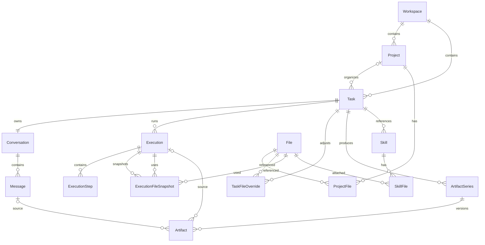

# DATA_MODEL.md — mousehole 数据模型

**文档版本：** v0.2.0-mvp  
**状态：** living（长期维护）  
**最后更新：** 2026-11-23  
**定位：** 核心实体、关系、不变量、删除规则与迁移策略。**字段级定义以 `backend/app/modules/*/models.py` 和 `backend/alembic/versions/` 为准**，本文不复制完整字段表。  
**相关文档：** `ARCHITECTURE.md`（模块与流程）、`ROADMAP.md`（阶段规划）、`UI_GUIDE.md`（界面）。

---

## 1. 设计原则

1. **组织与执行分离**：Workspace/Project/Task 组织工作；Execution 记录实际执行。
2. **对话与执行分离**：Conversation 记录交流；Execution 记录工作过程；成果不依赖对话存在。
3. **原始文件与成果分离**：File 是用户资料；Artifact 是独立成果，版本不覆盖历史。
4. **文件只存一份**：存储与引用分离；上传到 Library ≠ 所有 Task 可读。
5. **上下文显式**：可用 ≠ 实际输入；预算在构建时决定，执行记录只记实际使用。
6. **增量扩展**：新阶段只加表/列，不改既有关系；所有变更走 Alembic。

通用约定：主键 UUID v4；枚举用 VARCHAR + CHECK；时间 UTC；外键删除规则显式声明。

---

## 2. 核心实体

| 分组 | 实体 | 作用 |
|---|---|---|
| 组织层 | Workspace | 单例工作空间（含 context budget 覆盖） |
| 组织层 | Project | 长期项目，可归档 |
| 组织层 | Task | 工作目标；属于 Project 或 Global |
| 交流层 | Conversation | Task 下的交流记录（与 Task 1:1） |
| 交流层 | Message | 消息；`metadata` JSON 记录引用文件/Skill/工具步骤 |
| 执行层 | Execution | 一次运行；状态、模型快照、usage、错误 |
| 执行层 | ExecutionStep | 运行步骤（已持久化） |
| 执行层 | ExecutionFileSnapshot | 实际参与的文件、直接/摘要、hash |
| 资源层 | File | 用户资料；全局 Library 或 Task 临时文件 |
| 资源层 | ProjectFile | Project ↔ File 引用 |
| 资源层 | TaskFileOverride | Task 对继承文件的额外引用/排除 |
| 成果层 | ArtifactSeries | 同一类成果的版本系列 |
| 成果层 | Artifact | 独立成果；版本递增、`current` 指针 |
| 能力层 | Skill / SkillFile | 全局 Skill 库与资料附件 |
| 能力层 | PromptTemplate | 规划中（Phase 5，未实现） |

详细字段清单：`backend/app/modules/*/models.py`；迁移历史：`backend/alembic/versions/`。

---

## 3. 实体关系（核心）



> 图只表达核心关系；新增表见 §5。`Artifact.source_execution_id`、`source_message_id` 均可空，成果独立存在。

---

## 4. 关键规则（必须由 Service 保证）

### 4.1 工作组织

- 只有一个 Global Workspace；Task 可不建 Project。
- Task 一旦创建，`project_id` 固定，不跨 Project 迁移。
- Project 归档不等于删除；历史 Task/Artifact 保留。

### 4.2 Conversation 与 Message

- Conversation 与 Task 1:1（Phase 5 不引入多 Conversation，用上下文重置点缓解）。
- Message 的 `metadata` 记录：Skill 与文件清单、预算/截断状态、工具步骤与耗时；**不存完整 Prompt 或文件全文**。

### 4.3 File 与上下文引用

- 上传到 Library 的文件可被多个 Project/Task 引用；Task 只能读取自己可用范围内的文件。
- Project Task 默认继承 Project 文件；`TaskFileOverride` 用于额外引用或排除。
- 临时文件：`is_temporary=true` + `owner_task_id`，只属于某个 Task，不出现在 Library；Chat 只随当前一轮生效。
- 删除文件：先检查引用/快照；有引用时返回 409（先解除引用），临时文件按生命周期清理；不物理删除仍被历史快照引用的文件。

### 4.4 Execution

- 同一 Task 的 Execution 用 `sequence` 递增（UNIQUE(task_id, sequence)）；重跑新增记录，不覆盖历史。
- 状态：`pending / running / completed / failed / cancelled`；取消 ≠ 失败。
- 模型与参数在创建时快照，之后不重写；`skill_id/skill_name` 为快照字段。
- 文件快照只记录**实际参与**的文件；`usage_mode` 为 `direct / summarized`。
- 应用重启：pending 重新排队，running 标记 failed（不新增 Interrupted 状态）。
- Artifact 保存失败时，Execution 不得标记 completed。

### 4.5 Artifact

- `ArtifactSeries`：同一 Task 下标题唯一；`current_artifact_id` 指向当前版本。
- `Artifact`：`version` 从 1 递增；UNIQUE(series_id, version)；只追加，不原地覆盖。
- `source_type`：`execution / chat / manual`；`source_execution_id`、`source_message_id` 可空。
- 删除单版本：保留其他版本；系列为空时删除系列；删除当前版本时 `current` 回退到最新剩余版本。
- 下载/预览按版本取内容；`content_type` 预留未来类型，`storage_key` 预留文件型成果。

### 4.6 Skill

- 全局 Skill Library；名称唯一；描述/指令/System Prompt 可选。
- SkillFile 通过相对路径保存文件夹结构；File 仍只存一份。
- Task 当前按消息引用 Skill；`task_skills` 表保留给未来长期绑定（当前 UI 未启用）。
- Execution 记录 Skill 快照，不随后续修改变化。

### 4.7 删除规则

| 实体 | 规则 |
|---|---|
| Workspace | 不提供物理删除 |
| Project | 归档；删除前检查关联 |
| Task | 删除时清理临时文件与引用行；历史 Execution/Artifact 保留 |
| Conversation | 随 Task 生命周期 |
| File | 软删/引用检查；被引用返回 409 |
| Execution | 历史保留；不级联删除 Artifact |
| Artifact / Series | 单版本删除；当前版本回退；被 Task 引用时返回 409（Phase 5） |
| Skill | 删除前解除 Task/SkillFile 关联；历史 Execution 快照保留 |

---

## 5. Phase 5 规划增量（未实现）

> 阶段规格见 `ROADMAP.md` §4。以下均为增量；落地时按此写 Alembic 迁移，落地后把本节改为“实装补充”。

### 5.1 `task_artifacts`（Task 引用成果，钉版本）

| 字段 | 类型 | 说明 |
|---|---|---|
| id | UUID PK | 主键 |
| task_id | UUID FK tasks（CASCADE） | 引用方 |
| artifact_id | UUID FK artifacts（RESTRICT） | 被引用成果 |
| artifact_version | Integer | 引用时钉住的版本 |
| created_at | DateTime | 引用时间 |

约束：UNIQUE(task_id, artifact_id)；索引 artifact_id。被引用成果删除 → 409；Task 删除级联；新版本不自动扩散。

### 5.2 `execution_artifact_snapshots`（执行实际使用的成果）

| 字段 | 类型 | 说明 |
|---|---|---|
| id | UUID PK | 主键 |
| execution_id | UUID FK executions（RESTRICT） | 所属执行 |
| artifact_id | UUID FK artifacts（RESTRICT） | 成果 |
| artifact_version | Integer | 实际使用版本 |
| title_snapshot | String(300) | 标题快照 |
| content_hash_snapshot | String(64) | 内容 SHA-256 |
| usage_mode | VARCHAR（CHECK: direct / summarized） | 使用方式 |
| created_at | DateTime | 记录时间 |

约束：UNIQUE(execution_id, artifact_id, artifact_version)。与 `execution_file_snapshots` 并列，不改既有表。

### 5.3 `executions.context_manifest`（JSONB，可空）

```json
{
  "version": 1,
  "budget_tokens": 32768,
  "model_window": 65536,
  "truncated": false,
  "items": [
    {"kind": "file", "id": "...", "name": "spec.pdf", "tokens": 1200, "usage_mode": "direct", "reason": null},
    {"kind": "artifact", "id": "...", "name": "分析报告", "tokens": 900, "usage_mode": "summarized", "reason": "budget"},
    {"kind": "skill_asset", "id": "...", "name": "模板.md", "tokens": 300, "usage_mode": "direct", "reason": null}
  ]
}
```

规则：只存清单与统计，**不存全文或 Prompt**；执行完成后不再修改。

### 5.4 `prompt_templates`

| 字段 | 类型 | 说明 |
|---|---|---|
| id | UUID PK | 主键 |
| workspace_id | UUID FK workspaces（RESTRICT） | 所属 Workspace |
| name | String(200) | 名称 |
| description | Text / Nullable | 说明 |
| content | Text | 模板内容 |
| created_at / updated_at | DateTime | 时间 |

约束：UNIQUE(workspace_id, name)。Phase 5 仅用于预填 Task 描述/指令，不改变 Execution Pipeline。

### 5.5 `conversations.context_reset_at`

- DateTime，可空；构建 Chat 上下文时只取 `created_at > context_reset_at` 的消息。
- 清空上下文 = 设为当前时间；“从这里重开” = 设为该消息时间；恢复 = NULL。
- 历史 Message 不删除、不修改；不改变 1:1 关系。

### 5.6 迁移约定

- 全部增量；每个迁移提供 downgrade；升级前备份。
- 命名建议：`o5p6q7r8s9t0_phase5_artifact_reuse.py`（后续按时间序）。
- 不引入 pgvector/pg_trgm 作为必需依赖；搜索索引按需评估。

---

## 6. 事实源与工程约定

- **字段/约束事实源**：`backend/app/modules/*/models.py`；**变更事实源**：`backend/alembic/versions/`（当前 head `n4o5p6q7r8s9`）。
- 本文只维护：实体关系、业务不变量、删除规则、迁移策略、当前阶段增量。
- 任何表结构变化必须走 Alembic；禁止只改库或只改模型。
- 测试：核心规则（文件继承、状态流转、版本号、删除引用检查）必须有测试；Phase 5 起补 Postgres 集成测试。
- 枚举新增/修改属于“不可自行决定”，需先提案。
